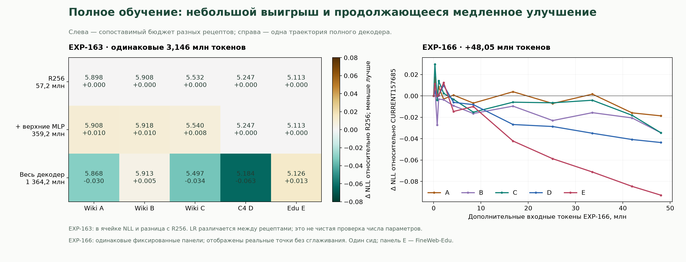

# Extent Technical Report — Volume II

**Обновлено:** 5 ноября 2026. **Охват:** результаты EXP-129–168 и clean-start EXP-171, инженерный отказ EXP-169, аудит происхождения весов, подготовленные EXP-170 и бенчмарк EXP-172.

Это продолжение [первого тома](extent%20technical%20report.md), а не повторная редакция его исторических записей. Первый том заканчивается результатом EXP-155 и планом EXP-156; результаты части EXP-130–154 туда не были перенесены. Здесь этот пробел восстановлен по архивам. Навигация по проекту — [RESEARCH.md](RESEARCH.md).

## 1. Как читать статусы

| Метка | Значение |
|---|---|
| **MEASURED** | Есть полученный отчёт запуска или конкретный измеренный checkpoint. Указанные результаты ограничены его выборкой и бюджетом. |
| **DERIVED** | Арифметика по измеренным значениям или точной конфигурации. |
| **ENGINEERING** | Проверка реализации, воспроизведения, сохранения, градиентов или исполнения. Не результат качества. |
| **PREPARED** | Протокол/код готовы; полученного научного результата здесь нет. |
| **MISSING** | В рассмотренных архивах нет пригодного отчёта. Это не доказательство, что запуск не состоялся или оказался неудачным. |
| **HYPOTHESIS** | Возможное объяснение, ещё не выделенное причинным экспериментом. |

`deadline_partial` может означать нормальную остановку по времени с сохранённым результатом. `completed` у notebook/родителя не гарантирует принятые обучающие шаги. Ошибка одного worker не отменяет отдельные валидные результаты другого, но может разрушить парное сравнение. CURRENT, зарегистрированный BEST и произвольно выбранный минимум — разные endpoints.

## 2. Главное исправление: какие именно веса мы восстанавливали

**ENGINEERING / аудит кода:** основная цепочка нынешних checkpoint не начинается с исторического прямого Q/K/V/O transplant. В `scripts/m3q_allocation_campaign.py:153` EXP-069 создаёт Mamba через случайный `mamba.init`, затем обучает её на целях учителя: 1024 dual-шага, калибровка readout и 2048 recurrent decoder-aware шагов. Исходный [протокол EXP-069](results/EXP-069-allocation-protocol.md) прямо описывает random initialization.

EXP-072 последовательно дообучает эту подготовленную bank на входах гибридного префикса. В `extent/t4_patient.py:113–126` последующие восстановления загружают именно EXP-069 prep / EXP-072 ONPOLICY endpoints с проверками pin/hash. Таким образом, случайной была **инициализация заменяющих Mamba**, а затем они многократно обучались. Эмбеддинги, MLP, нормы и оставленные attention исходного Qwen не были случайной полной LLM.

```text
Исходный Qwen: сохраняемые части
             +
EXP-069: случайная Mamba → локальное обучение на выходах Qwen
             ↓
EXP-072: последовательное обучение на изменённых входах
             ↓
EXP-111 → EXP-136 → 145 → 147 → 153 v2 → 155
             ↓
EXP-160/161: смешанная CE/KL, переход к свежему C4
             ↓
EXP-163 FULL → 164 → 166 → выбранная ветка 167 → 168

Отдельная новая линия:
исходный Qwen → прямое сохранение голов Q/K/V/O → EXP-170 (ещё без результата)
```

Полный [аудит EXP-170](results/EXP-170-clean-start-audit.md) проверяет и историческую полученную ревизию `a385256db8cd34dd09b6dc54458c54cec54a9911`. Это установленная особенность прежнего рецепта, а не доказанная порча файлов.

Следствия для интерпретации:

- Старые результаты остаются результатами восстановления **подготовленного гибрида с random-initialized replacement blocks**.
- Они не доказывают эффективность прямой инициализации Mamba весами Q/K/V/O. Все эксперименты после EXP-069 также нельзя автоматически объявлять одной веткой: были отдельные контроли и ответвления.
- Исторический exact SISO→MIMO lift сохранял операцию своего SISO-источника, а не эквивалентность исходному softmax attention. Усреднение голов в той семье могло терять информацию до lift, но это не инициализатор random bank EXP-069.
- Аудит происхождения не доказывает, что именно ранняя подготовка вызвала позднее плато. Для этого нужен сопоставимый clean-start контроль.

## 3. Восстановленный журнал EXP-129–155

Все A/B/C в этом разделе — разные многократно просмотренные Wiki-панели. Числа между колонками нельзя соединять в одну траекторию. Бюджеты ниже — дополнительные принятые входные позиции соответствующего запуска, без унаследованной подготовки.

| EXP | Статус и результат | Что это позволяет заключить | Архив / разбор |
|---|---|---|---|
| 129 | **MEASURED:** pre-gate RMS last A7.19182 против control7.24449 при разных финальных бюджетах. | Одна нормализация даёт небольшой сдвиг; самостоятельного выхода далеко ниже7 здесь нет. | [129–132 analysis](results/EXP-129-132-session-1-analysis.json) |
| 130 | **MEASURED:** NORM-TANH-RESET last A/B/C6.746898/6.773308/6.480252 после879,104 позиций. Без reset last A7.17359 после894,720. | Комбинированная интервенция перспективнее; её отдельные компоненты и неравные last-бюджеты не дают чистой причинной оценки. | [raw130](results/EXP-130-session-1.json), [общий разбор](results/EXP-129-132-session-1-analysis.json) |
| 131–132 | **MEASURED:** unlock/MLP-варианты не воспроизвели сильный эффект reset130; для части профилей131 есть расхождения. | Не считать увеличение обучаемой области или чистый KL универсальным решением. | [общий разбор](results/EXP-129-132-session-1-analysis.json) |
| 133 | **ENGINEERING:** получен failed-report до принятого результата восстановления. | Не использовать как отрицательный результат обученного метода. | [failed133](results/EXP-133-failed-session-1.json) |
| 134 | **PREPARED / MISSING:** протокол есть; пригодного принятого результата в этом обзоре нет. | Не включать в таблицу измеренных побед/поражений. | [протокол130–134](results/EXP-130-134-protocol.md) |
| 135 | **ENGINEERING:** source replay прошёл, но gradient relative L2≈0.5306 превысила0.15;0 новых принятых шагов. | Направление cosine≈0.9996 само по себе не сертифицирует масштаб градиента. Причина расхождения не установлена. | [135–136 audit](results/EXP-135-136-streamed-v2-analysis.json) |
| 136 | **MEASURED:** FULL last A/B/C6.000789/6.004432/5.617432;3,222,016 новых позиций. PROJECTIONS last6.112766/6.179138/5.728322;3,085,056. | При matched10240 FULL немного лучше PROJECTIONS; оба существенно улучшают источник. | [raw136](results/EXP-136-streamed-v2-session-1.json), [разбор](results/EXP-135-136-streamed-v2-analysis.json) |
| 137 | **MEASURED:** dt-only last A7.25080; MIMO-X-only6.997996, с более ранним лучшим checkpoint. | Отдельные dt/MIMO-X reset слабее projection/full reset в этом сравнении; единственный виновник плато не установлен. | [analysis137](results/EXP-137-streamed-v2-analysis.json) |
| 138 | **MEASURED:** от130 после folding/freshR32/freshAdam CE last A6.000900; pure forwardKL6.176463. CE лучше на matched4096/8192. | Этот pure-KL рецепт уступает CE; смешанная CE+KL и другие режимы этим не отвергнуты. | [analysis138](results/EXP-138-streamed-v2-analysis.json) |
| 139–142 | **PREPARED / MISSING:** отдельные протоколы и launch-код есть; пригодные результаты здесь не предъявлены. | Состояние неизвестно, а не «все провалились». | [135–141](results/EXP-135-141-protocol.md), [142](results/EXP-142-protocol.md) |
| 143 | **ENGINEERING → MEASURED:** ранние сбои отдельно; repaired PROJECTIONS worker1 last A5.906142 после3,159,552 позиций. | Продолжение без нового folding/rank/reset Adam само ещё улучшалось. Worker0 здесь не подменяется результатом worker1. | [repaired143](results/EXP-143-fixed-worker1-analysis.md) |
| 144 | **MEASURED:** original LR лучше LR/3 по A/B/C на matched8192/10240. Last original A5.754784, LR/3 A5.803475 при разных last-бюджетах. | Ранний выигрыш меньшего LR не гарантировал поздний. | [paired144](results/EXP-144-paired-analysis.md) |
| 145 | **MEASURED, неполная пара:** fold+newR32+freshAdam last A/B/C5.782680/5.804467/5.364202;3,169,024 новых позиций. Другой worker упал. | Валидное улучшение одной траектории; не чистое доказательство пользы folding или ранга. | [analysis145](results/EXP-145-analysis.md) |
| 146 | **MEASURED:** второй preparation seed456; FULL last A5.976876, PROJECTIONS6.118156, matched10240 тоже в пользу FULL. | Ограниченная чувствительность к preparation seed проверена; это не независимая корпусная репликация. | [analysis146](results/EXP-146-analysis.md) |
| 147 | **MEASURED:** обычное продолжение145 до CURRENT31126, A≈5.6921; без нового folding/rank/reset. | Более длинное обучение сохраняет небольшой прогресс; жёсткий предел5.78 не установлен. | [analysis147](results/EXP-147-fold-continue-analysis.md) |
| 148 | **MEASURED:** восстановлен отсутствовавший same-factors/freshAdam контроль; другая ветка проверяет LR/10 из145. | У двух worker разные источники; напрямую сравнивать их last нельзя. | [analysis148](results/EXP-148-fold-continue-analysis.md) |
| 149–152 | **PREPARED / MISSING:** исходы TPU не представлены в рассмотренном архиве. | Не засчитывать как качество, успех или провал метода. | [149–154 protocol](results/EXP-149-154-protocol.md) |
| 153 v1 | **ENGINEERING:** folded R64/R256 не прошли source replay;0 принятых шагов. | Это не результат обучения увеличенного ранга. | [153–154 analysis](results/EXP-153-154-continuation-matrix-analysis.md) |
| 153 v2 | **MEASURED, частичный snapshot:** сохранены исходные факторы, добавлены zero-effect компоненты; freshAdam у R64/R256. На общем new6144 A5.604823/5.575060. | R256 лучше на этой точке; нет matched freshAdamR32, завершённого горизонта или чистой оценки ранга. | [v2 protocol](results/EXP-153-rank-growth-v2-protocol.md), [snapshot provenance](paper/figures/continuation_provenance.json) |
| 154 | **MEASURED:** ordinary worker0 проходит replay, A5.69210→5.616958 за1,278,464 позиций; folded worker1 не проходит replay. | Смешанный aggregate-status не отменяет валидного ordinary продолжения. | [153–154 analysis](results/EXP-153-154-continuation-matrix-analysis.md) |
| 155 | **MEASURED,2 сессии:** R256 CURRENT37910→80260→118304. A5.573295→5.109496→4.975879; C5.200393→4.665559→4.457787. Суммарно20,580,864 новых позиций. | Продолжение улучшает повторно используемые панели; широкие способности этим не измерены. | [session1 analysis](results/EXP-155-analysis.md), [session2](results/EXP-155-session-2.json) |

### Что действительно вывело ниже прежнего уровня около7

**MEASURED:** путь включает внутреннюю pre-gate нормализацию, tanh обработки углов, комбинированные resets и последующее обучение. Самая сильная отдельная reset-интервенция в137 — projections; dt-only и MIMO-X-only не объясняют весь эффект. Затем помогали дополнительные шаги, reparameterization/folding в отдельных ветках и source-preserving rank growth. Эти последовательные изменения не являются одной изолированной проверкой механизма.

**Не установлено:** что все улучшения вызваны только ограничением активаций; что увеличение ранга всегда необходимо; что folding экономит суммарные вычисления; что ранний local fit был полезнее clean head-preserving init. Снижение короткоконтекстного NLL не сопровождалось убедительным восстановлением пользы длинного контекста в маленьких tail-аудитах.

## 4. EXP-156–159: качество и переход к другим целям обучения

### EXP-156 — измеренный разрыв с исходным Qwen

**MEASURED:** замороженный155 CURRENT80260 сравнивается с исходным Qwen на одинаковых zero-shot примерах. Полученный partial report содержит808 общих ARC-Easy и807 примеров каждой другой задачи, а не полный официальный benchmark.

| Задача / правило | Qwen | Гибрид80260 |
|---|---:|---:|
| ARC-Easy, acc_norm |66.71%|28.47%|
| ARC-Challenge, acc_norm |45.72%|23.54%|
| PIQA, acc_norm |77.20%|52.04%|
| WinoGrande, accuracy |62.95%|48.95%|
| HellaSwag, acc_norm |67.66%|27.01%|
| MMLU, zero-shot accuracy |62.58%|22.06%|
| English stories NLL |1.858|7.439|
| Russian Wiki NLL |1.848|11.447|

Source replay и отдельные reference checks прошли; ранее полученные startup/OOM ошибки не являются этим quality result. Генерации у гибрида часто плохие. **Вывод:** уменьшение Wiki A/B/C не означало восстановленных общих способностей. Причина разрыва и качество гораздо более позднего168 здесь не измерены. [Received summary156](results/EXP-156-received-summary.json).

### EXP-157 — полное обучение при старом источнике/CE

**MEASURED:** от155 CURRENT118304, свежий Adam, protectedR256 против full decoder на обычной CE. На matched8192 новых шагов A≈4.9509 у R256 и10.0811 у full decoder. Это отрицательный результат конкретного рецепта полной адаптации, а не доказательство невозможности обучать полный decoder. [Received summary157](results/EXP-157-received-summary.json).

### EXP-158 — другой замороженный checkpoint

**MEASURED:** сравнение80260 и118304 содержит1536 вопросов и24 генерации на модель. English NLL7.43896→7.24573, Russian11.44676→11.16595. ARC-Easy acc_norm27.734%→33.984%; номинальный paired CI разницы1.95…10.55pp. Интервалы остальных пяти задач включают ноль. Генерация остаётся слабой. Это некоторое улучшение вне старых Wiki-панелей, но не широкое восстановление. [Raw158](results/EXP-158-session-1.json).

### EXP-159 — добавление внутренних целей

**MEASURED, короткий screen:** .5 CE+.5 forwardKL сравнивается с той же смесью плюс0.1 normalized intermediate-output MSE в четырёх точках глубины. На matched6144 шагах /1.572864M входов A/B/C без hidden loss4.903925/5.017014/4.423783, с ней4.903264/5.012825/4.415786. Разница мала и односеедовая. Этот screen не устанавливает сильного выигрыша, но не отвергает полноценный отдельный alignment-stage с другим бюджетом и инициализацией. [Протокол159](results/EXP-159-protocol.md), [числовое извлечение и raw SHA](paper/latest_recovery_data.json).

## 5. EXP-160–162: влияние корпуса

EXP-160 вводит .5 CE+.5 forwardKL(T=1) от замороженного исходного Qwen. Distillation применяется к распределению следующего токена на позициях текста, не только к концу ответа. EXP-161 продолжает две ветки с собственными Adam и физическим batch6, context256: циклический исторический Wiki pool и последовательные свежие C4 windows без неявных эпох.

**MEASURED, описательные last endpoints:**

| EXP-161 CURRENT | Новые входы161 | Wiki A | Wiki B | Wiki C | C4 D | English128 | Russian128 |
|---|---:|---:|---:|---:|---:|---:|---:|
| Wiki cyclic,154749 |53.096M|4.6476|4.7463|4.0945|7.0781|6.1032|11.2334|
| C4 fresh,154852 |52.889M|5.9589|6.0233|5.6023|5.2313|4.6167|7.7625|

Меняются и домен, и разнообразие данных. Поэтому это не выделенная оценка одного dedup/diversity-фактора. Концы имеют немного разные token budgets. Однако выбор только минимального Wiki NLL скрывал бы существенный domain tradeoff. Именно **C4 CURRENT154852**, а не его исторический Wiki-selected BEST, становится источником дальнейшего full-decoder пути. [Received161](results/EXP-161-received-summary.json), [160 protocol](results/EXP-160-protocol.md).

EXP-162 **PREPARED / без принятого сравнительного результата здесь:** C4 continuation против FineWeb-Edu из одинакового154852 с Adam. Сообщение о старте и старый `/check` от161 не являются сравнением162. [Протокол162](results/EXP-162-protocol.md).

Корпуса — pinned C4/en и FineWeb-Edu/sample-10BT; tokenizer исходного Qwen, конкатенация документов с EOS, exact normalized-document dedup, отдельно зарезервированная validation. Это не semantic dedup, не полная benchmark decontamination и не гарантия отсутствия текста в первоначальном pretraining Qwen. Старый Wiki FIT действительно повторялся; более поздние fresh C4/Edu ветки читаются последовательно.

## 6. EXP-163–166: полная адаптация decoder

### EXP-163 — сопоставимый короткий budget

**MEASURED:** одинаковый154852, свежий FineWeb-Edu prefix и fresh Adam; разные scope/rates, поэтому сравниваются рецепты, а не одна переменная «число параметров».

| На matched2048 шагах /3,145,728 входах | Обучаемые координаты | Wiki A | C4 D | Edu E | English16 |
|---|---:|---:|---:|---:|---:|
| R256 |57.2M|5.8980|5.2474|5.1130|4.6625|
| R256+upper8 MLP |359.2M|5.9081|5.2474|5.1134|4.6655|
| Full decoder |1,364.2M|5.8676|5.1843|5.1263|4.5555|

Full decoder лучше на D и English, но не на E. Это не глобальная победа на всех панелях. Last full branch принимает2832 шага /4,349,952 входа, а полных финальных diagnostics всех трёх веток нет. [Received163](results/EXP-163-received-summary.json).

EXP-164 **MEASURED/ENGINEERING:** один принятый256-позиционный шаг, затем memory guard. EXP-165 **ENGINEERING:**0 принятых шагов; ни один compiled batch не принят. Они не доказывают влияние learning rate или качества метода. [164](results/EXP-164-received-summary.json), [165](results/EXP-165-received-summary.json).

### EXP-166 — устойчивое, но небольшое улучшение

**MEASURED:** из CURRENT157685, Adam2833 / Edu cursor16993, full decoder1,364,173,952 координаты; embeddings/finalnorm/head заморожены. .5 CE+.5 forwardKL, LR mixer/MLP1e-5, norms1e-6. Все decoder-градиенты сквозные; staged execution не превращает их в независимое обучение слоёв.

23,460 принятых обновлений /48,046,080 новых входов, финальный CURRENT181145:

| Панель | Источник | Last166 |
|---|---:|---:|
| Wiki A |5.870242|5.851569|
| Wiki B |5.914796|5.880271|
| Wiki C |5.491221|5.456707|
| C4 D |5.176441|5.132805|
| Edu E |5.110410|5.017505|

E поздно продолжает снижаться; нельзя утверждать полный арест обучения. English/Russian128 last4.507731/7.542571; сравнение с16-window source как с идентичной выборкой недопустимо. Новые downstream benchmarks на этом checkpoint отсутствуют. [Received166](results/EXP-166-received-summary.json).



График относится к старой подготовленной линии. Он не показывает результаты нового head-preserving EXP-170.

## 7. EXP-167 — повышение LR не решило проблему

**MEASURED:** все три ветки завершают одинаковые4096 обновлений /8,388,608 новых позиций из CURRENT181145 с унаследованными моментами, одинаковым Edu prefix и batch8. Масштабируются также rates норм. Это конечный LR-screen, не три независимых длинных обучения.

| LR multiplier | Wiki A | C4 D | Edu E | English128 | Russian128 |
|---|---:|---:|---:|---:|---:|
| x1: mixer/MLP1e-5 |5.852621|5.118224|5.005715|4.504802|7.555007|
| x3 |5.865014|5.135283|5.015805|4.523174|7.593443|
| x10 |6.073702|5.311046|5.157800|4.724912|7.928087|

x1 лучше на всех семи измеренных панелях, включая не показанные в таблице B/C. Выбрана x1 CURRENT185241. Это не исключает других schedules, но не поддерживает объяснение «достаточно увеличить LR». [Received summary167](results/EXP-167-received-summary.json) содержит raw SHA и все семь endpoints.

## 8. EXP-168 — длинное продолжение

**MEASURED:** источник167x1 CURRENT185241 / Adam30389 / Edu237441; сохраняются scope, objective, LR и моменты. Принято75,145 обновлений batch8 /**153,896,960** новых входов. Остановка по soft request; finalization completed, pending HF пуст.

| Панель | Источник167x1 | Last168 CURRENT260386 | Изменение |
|---|---:|---:|---:|
| Wiki A |5.852621|5.767075|−0.085546|
| Wiki B |5.888258|5.804319|−0.083939|
| Wiki C |5.458523|5.383454|−0.075069|
| C4 D |5.118224|5.073118|−0.045107|
| Edu E |5.005715|4.844616|−0.161099|
| English128 |4.504802|4.430823|−0.073980|
| Russian128 |7.555007|7.754618|+0.199612|

E продолжает поздно улучшаться; D в финале немного хуже промежуточного5.069574. Обучение движется, но перенос улучшения не равномерен: русский текст ухудшился. Уменьшение E не устанавливает ни восстановление исходных способностей, ни конечное отсутствие плато. Новых полноценных benchmarks этого CURRENT нет. [Received168](results/EXP-168-received-summary.json).

**DERIVED / производительность именно этого отчёта:**

| Фаза | Часы |
|---|---:|
| Обновления |29.441|
| Evaluation |0.402|
| Planner |0.0368|
| Локальное checkpointing |0.431|
| Report/remote sync |0.605|
| Неатрибутированные setup/IO |2.305|
| Весь runner |33.221|

153,896,960 /119,594.7024 ≈**1287 принятых входов/с сквозного времени**, а не скорость одного kernel. Для более раннего первого partial167 было около1500 входов/с шага против542 входов/с всего invocation; его неразмеченные накладные расходы нельзя задним числом разложить по причинам. Эти данные сами по себе не измеряют MFU или «4% мощности».

## 9. Счёт токенов выбранной линии

**DERIVED:** из [числового ledger](paper/latest_recovery_data.json), без альтернативных веток поиска:

| Этап | Принятые входные позиции |
|---|---:|
| EXP111 |8,388,608|
| EXP136 |3,222,016|
| EXP145 |3,169,024|
| EXP147 |1,577,216|
| EXP153 v2 до источника155 |1,736,704|
| EXP155,2 сессии |20,580,864|
| EXP160 C4 prefix |541,440|
| EXP161 C4 |52,889,088|
| EXP163 FULL |4,349,952|
| EXP164 FULL |256|
| EXP165 FULL |0|
| EXP166 FULL |48,046,080|
| EXP167 выбранная x1 |8,388,608|
| EXP168 FULL |153,896,960|
| **Всего full-model input presentations выбранного пути** |**306,786,816**|

Отдельно local/block preparation: **17,301,504** layer-input presentations. Арифметическая сумма **324,088,320** не означает столько уникальных текстовых токенов или compute-equivalent end-to-end работы. В неё не входят все альтернативы, LR-search, отвергнутые предложения, profiler/planner/replay cost или исходный pretraining Qwen. Teacher-input presentations учитываются отдельно; их нельзя объявлять новыми уникальными student-токенами.

## 10. EXP-169–170: что подготовлено и что ещё не измерено

### EXP-169: диагностика старого CURRENT

**PREPARED / ENGINEERING:** из168 CURRENT260386. Изолированные процессы подбирают integer batch с шагом+1 до ошибки/лимита времени, сравнивают исполнители, проверяют gradient/source replay. Подготовлены профили teacher-prefix/hybrid-prefix, CE/KL gradient pairs, clipping/update ratios, BF16 cast diagnostics и короткие matched CE-only/mixed pilots.

34 локальных проверки, включая8 виртуальных CPU devices, не являются результатом физического TPU. Данные опубликованы как существующие verified packs; успешная публикация не означает успешного обучения169. В рассмотренных источниках результата этого запуска пока нет. [169 protocol](results/EXP-169-protocol.md), [launch](results/EXP-169-launch.md).

### EXP-170: новая инициализация непосредственно из Q/K/V/O

**PREPARED / ENGINEERING:** отдельная PyTorch-линия с исходного `Qwen/Qwen3-1.7B-Base@ea980cb0a6c2ae4b936e82123acc929f1cec04c1`; старые bank, adapters и Adam не загружаются. ГеометрияH16/G8/P128/N128/inner2048/MIMO4 сохраняет полные проекции и принадлежность голов; Q/K нормы и O копируются с поэлементной проверкой. Два query-head на KV-group адаптированы к четырём rank slots без усреднения голов.

Z-gate остаётся явно случайным архитектурным параметром; token-dependent dynamic rows начинают с нуля и обучаются. Это не заявление о100% наследовании всех параметров или эквивалентности softmax attention. Нормализация/tanh присутствуют с первого шага. Рецепт атрибутирован pinned реализации arianraje; полного воспроизведения его trainer/data/4B geometry здесь нет.

Stage1 обучает **все798,316,128 параметров27 новых mixers** на внутренних выходах исходного Qwen с замороженными residual/MLP. Эффективный batch16×4096,1526 updates /100,007,936 свежих входов. AdamW(.9,.95), peak1e-3, warmup46, cosine до0.1 peak, globalclip1. Общий teacher pass и немедленный backward слоя избегают27 копий учителя/hidden-state bank. Увеличенная geometry делает гибриды крупнее исходных1.7B; число параметров записывается отдельно.

PyTorch eager/compiled blockwise SSD и optional fused MIMO проверяются через CPU-parent, изолированные CUDA-процессы и реальные BF16 numerical gates. В отчёт пишутся complete-update timing, teacher/student/backward/optimizer phases, VRAM/utilization/power и optional bounded profiler. Выбор+1 batches1…8 ограничен бюджетом; это не гарантия, что каждый кандидат будет замерен. Корректность обычной рекурсии и blockwise вычисления проверена по выходам/градиентам, включая ненулевые углы и AOT capture.

**44 локальных CPU checks прошли; запуска на реальной GPU, замера ускорения и100M quality result пока нет.** Измеряться будут ordinary NLL teacher/gqa4/gqa7 на одинаковой Edu4096 validation, а не старые A–E. Предложенный ранее random pilot в этом runner не реализован; преимущество над matched random init не установлено. После alignment потребуется отдельно оценивать необходимость end-to-end KD. [Полная инструкция170](results/EXP-170-pytorch-launch.md), [протокол и границы исходного плана](results/EXP-170-protocol.md).

## 11. Что можно утверждать сейчас

**Подтверждено в указанном объёме:** восстановление старой подготовленной линии ниже прежнего уровня около7; дальнейшие небольшие gains без обязательного увеличения ранга; заметный domain tradeoff Wiki/C4; ограниченный выигрыш full-decoder recipe на части панелей; преимущество исходного LR над x3/x10 в matched167; медленное улучшение E в длинном168 при ухудшении русского; происхождение старой bank из random initialization с последующим teacher-target обучением.

**Не установлено:** причинное объяснение плато одним фактором; преимущество прямого Q/K/V transplant; полная эффективность подготовки+восстановления против корректных контролей; полезность последнего CURRENT на широких benchmarks; восстановление длинного контекста;14B quality; inference speed; эффективность или качество нового PyTorch clean-start170. Следующие результаты добавляются в этот том с исходным checkpoint, точной выборкой, token budget и границами сравнения.

## 12. Карта источников и обновлений

### 3 ноября2026: clean Q/K/V TPU171 подготовлен

**PREPARED / ENGINEERING:** отдельный [TPU171 protocol](results/EXP-171-protocol.md) и [готовый notebook/запуск](results/EXP-171-launch.md). Исходный Qwen напрямую; старые bank/Adam не реконструируются. Геометрия чистого170 сохраняется, но context1024/effective16 отличается от GPU4096/effective16. Stage1 учит все27 mixers на teacher-prefix targets; блоковый SSD и stacked-layer gradient scan с model-sharding на8 устройствах. Подбирается integer batch, измеряется полное effective update; фазы, Python-стеки, compile/first execution записываются отдельно.18 локальных проверок проходят, включая настоящие градиенты/Adam на8 виртуальных CPU devices; физического TPU результата и выигрыша скорости пока нет. Это следующий подготовленный эксперимент, не исправленный результат169.

### 3 ноября2026: получен неуспешный EXP-169

**ENGINEERING:** [aggregate](results/EXP-169-received-session-1.json) показывает timeout обоих batch1 probes: compiled607.556с, streamed608.095с; returncode−15 после остановки supervisor. Валидного fit нет, обучающие ветки не запускались. Это не установленный OOM и не результат качества. Данные восстановлены. Какая часть startup/source reconstruction/compile/measurement заняла лимит600с, без worker logs неизвестно. [Разбор](results/EXP-169-failure-analysis.md). Предыдущая отметка «результата169 нет» выше относится к состоянию на2 ноября; теперь получен именно этот инженерный исход. Новая clean Q/K/V TPU-линия пока не реализована и не проверена физически.

Научный журнал — этот том и архив первого; конкретные числовые отчёты/разборы — `results/`; компактная передача текущего состояния и эксплуатация — `HANDOFF.md`; связный текст статьи — `paper/draft.md` / `draft.ru.md`. Draft и HANDOFF могут содержать старые dated snapshots и не заменяют evidence ledger.

Полученные167/168 сведены в компактные [167](results/EXP-167-received-summary.json) и [168](results/EXP-168-received-summary.json) с SHA256 исходных пользовательских файлов. В репозиторий не копируются огромные runtime JSON, веса, приватные credentials или серверные пути. Их summaries не означают нового запуска или повторной полной проверки удалённого payload.

Для каждой следующей записи достаточно: вопрос → source/отличие от контроля → measured status/accepted work → endpoint/выборка → вывод и ограничения → ссылка на raw/summary/hash. PREPARED обновляется полученным результатом отдельной датированной записью; старый план не переписывается задним числом как подтверждённый факт. Третий том открывается при следующей крупной фазе, со ссылками и сохранённой нумерацией EXP.
# 5 November 2026 addendum — EXP171 received; EXP172 prepared

Clean head-preserving Q/K/V/O bank, fresh original Qwen initialization:
5120 accepted updates ×16×1024 = **83,886,080 input presentations**.
Status deadline_partial; physical batch8/effective16. Approximately2973 tokens/s
per update,2864 tokens/s across the training loop; not full-session throughput.
Training relative block-MSE first0.122204 → last0.001217; this loss is not NLL.

Composed hybrid held-out Edu NLL (same four1024-token windows,4092 targets):

| Step | Input tokens | 4 attention /24 Mamba | 7 attention /21 Mamba |
|---:|---:|---:|---:|
|0|0|14.760480|14.825125|
|128|2,097,152|3.692330|3.643495|
|256|4,194,304|2.869839|2.821507|
|1536|25,165,824|2.639221|2.619597|
|3072|50,331,648|2.611734|2.594828|
|4864|79,691,776|2.598124|2.583224|

Original Qwen on this panel2.476397. Final saved5120 has no separate final NLL
measurement. Small repeatedly observed panel, one seed, larger hybrids
(2.128B/2.077B vs1.721B), changed geometry/context/objective/lineage: cannot rank
this against old A-E recovery or infer full capabilities restored.
Evidence: [compact received artifact](results/EXP-171-received-summary.json).
Remote CURRENT5120 verified in HF dataset revision
d341d2b8f87592f617c44c92c5d7532669c75755; not the old random069 bank.

EXP172 is PREPARED quality measurement of frozen5120 on twoT4s: matched
teacher/gqa4/gqa7 zero-shot choices, independent text panels and qualitative
generation, conversion/precision gates, per-item durable progress. It has no
physical measurement yet. [Protocol and launch](results/EXP-172-protocol-and-launch.md).

## 6 November2026 — EXP172 complete quality result

Frozen clean171 CURRENT5120,83,886,080 training inputs; benchmark adds zero
training.6000 matched zero-shot questions/192 NLL windows/24 qualitative prompts.
[Full analysis](results/EXP-172-result-analysis.md),
[received summary and raw SHA](results/EXP-172-received-summary.json).
MMLU original62.4%,gqa4 45.1%,gqa7 51.9%; Hella67.3/62.2/62.6%.
Edu1024 NLL2.4359/2.5584/2.5483. All raw accuracies verified; no context
truncations. Strong retention of several tested abilities, substantial MMLU loss,
not complete teacher recovery. Nearly identical NLL of masks does not guarantee
equal capabilities;7-attention gains6.8pp MMLU over4-attention.

## 6 November2026 — EXP173 prepared, no scientific outcome yet

User selected only gqa7 for TPU9h. [Protocol/launch](results/EXP-173-protocol-and-launch.md).
Composed end-to-end CE+.5KL (actual .5CE+.5KL),21 mixer modules trainable,
original parts frozen; frozen171 CURRENT5120/fresh Adam/fresh Edu offset83,886,080.
Isolated +1 physical-batch planner at fixed effective16; full teacher/student/
backward/Adam timing, exact tiled vocabulary loss.17 CPU checks passed; no
physical TPU173 throughput, convergence or capability result.

## 8 November2026 — EXP173 received

The composed 7-attention hybrid starts from clean171 CURRENT5120. New Adam,
peak1e-4 with128-update warmup, .5CE+.5full-vocabulary teacher-to-student KL,
only the21 Mamba mixers trainable. Initial four-window Edu1024 replay2.581202
with teacher2.476397. Same held-out panel gives7.954306 at128 updates
(2,097,152 new input positions),7.315026 at the best post-start evaluation
(3968), and7.746794 at the last recorded evaluation (5632). Training CE
and KL also rise. The measurements document failure of this recipe to
retain the source quality. They leave the cause unresolved.

deadline_partial after5842 updates/95,715,328 new inputs. Saved CURRENT5842,
no pending sync in report. Final checkpoint has no exact-step held-out NLL
or downstream benchmark. Source171 quality evidence remains EXP172.

All16 physical batches fit; selected8 at3376.45tok/s, about3376.27tok/s
over accepted updates and3293.84tok/s across the training loop. Probe
processes total25.06min. Timing excludes preparation/planning/final HF
sync from the training-loop rate. [Received summary](results/EXP-173-received-summary.json).
