# Mamba-3 в Qwen: сдвиг распределения при композиции, численная устойчивость и пределы восстановления при переносе между архитектурами

[Английская версия](draft.md). Русский перевод той же редакции; рисунки общие с английским текстом.

**Рабочий черновик, обновлён 29 октября 2026 года. Не подан на публикацию.** Результаты относятся только к зафиксированным конфигурациям. EXP-111 и EXP-113 завершены; EXP-112 выполнен частично. Добавлены продолжения EXP-136, 144–148, 154, сохранённый срез EXP-153 v2 и полученные результаты до EXP-166 включительно. EXP-167 подготовлен, но результатов качества ещё нет. Это поисковые результаты преимущественно с одним сидом подготовки на повторно используемых валидационных наборах. Исторические отчёты EXP-153 v2 ещё имеют статус `running`: их сохранённые оценки не являются итогом завершённой кампании. Неудачные ветки EXP-153 v1 со сворачиванием весов отделены от переписанного v2. В черновике не заявляются восстановление качества до уровня исходного Qwen, превосходство инициализации всей модели или ускорение инференса.

## Аннотация

Для переноса предобученных трансформеров в языковые модели на основе пространства состояний недостаточно локально точного отображения блоков смешивания последовательности. Мы исследуем перенос Qwen в Mamba-3 MIMO через частичную замену блоков, композицию на полной глубине, последовательное восстановление и численно устойчивую адаптацию. Отображение SISO в MIMO, сохраняющее оператор, улучшает NLL на отложенных данных относительно случайной инициализации при частичной замене, однако это преимущество не сохраняется в проверенных протоколах восстановления всей модели. Диагностика на согласованных входах выявляет сильный сдвиг распределения остаточного потока при объединении независимо восстановленных блоков. Обучение заменяемых блоков на входах, полученных от постепенно изменяемой модели, существенно улучшает качество на полной глубине: при 24 заменах последовательное on-policy-восстановление достигает NLL 10.55 и 10.27 против 22.35 и 22.04 при том же числе обновлений на входах исходного учителя. Мы также обнаруживаем переполнение вычисляемой через сумму квадратов нормы в FP32 при конечных элементах градиента, сравнивая численные варианты обновления на одинаковых градиентах и состояниях оптимизатора. Устойчивый клиппинг и защищённые поправки ранга 32 затем снижают тестовую NLL всей модели с 12.97/12.28 до 7.27/7.31 за 2.10 млн дополнительных входных токенов на траекторию. Недавние эксперименты с одним сидом разделяют контроль масштаба активаций и восстановление качества: внутренняя нормализация перед гейтом резко уменьшает величину остаточного сигнала, не улучшая NLL при одинаковом числе шагов. При этом совместный сброс проекций динамики, смещений временного шага и входных коэффициентов MIMO улучшает NLL на всех трёх повторно используемых проверочных наборах на 0.31–0.39 при 3,072 обновлениях относительно того же нормализованного контроля. Разблокировка низкоранговых поправок динамики, добавление адаптации MLP и короткое обучение чистой forward-KL-дистилляцией не воспроизводят это улучшение. Значительный разрыв с учителем сохраняется; результат сброса носит поисковый характер и не определяет, какой компонент или этап подготовки создал ограничение. Полученные результаты разделяют локальную точность переноса, устойчивость композиции, численную корректность и эффективность обучения и обосновывают необходимость контролируемого сравнения полной стоимости, а не выводов по начальным участкам кривых восстановления.

Длинные поисковые продолжения опускаются ниже прежнего плато: линия сброса, сворачивания и продолжения достигает NLL A/B/C 5.692/5.718/5.292, а обычное продолжение ранга 32 улучшает её дальше. Рост до ранга 256 с сохранением исходной функции достигает 5.575/5.612/5.150 за 1.573 млн дополнительных входных токенов после этого обученного источника, против 5.605/5.636/5.195 у ранга 64 при том же новом бюджете. Это наблюдения одного сида на повторно используемой валидации из частичного сохранённого отчёта; контроль ранга 32 сохраняет Adam, рост ранга сбрасывает его, а полная стоимость подготовки не включена.

Поздние контроли данных выявляют обмен качеством: циклическая Wiki достигает NLL4.094 на Wiki C, но7.078 на C4 D; свежий C4 даёт5.602/5.231 на тех же соответствующих панелях. Продолжение полного декодера на свежем FineWeb-Edu затем улучшает E с5.1104 до5.0175 и D с5.1764 до5.1328 за48.05 млн дополнительных входных позиций. Небольшой выигрыш на одном сиде не устанавливает ограничение из-за LR или восстановление прикладных способностей; последний полный декодер ещё не проходил прежний парный бенчмарк задач.

## 1. Введение

Предобученные веса трансформеров содержат результат значительных затрат, который можно было бы использовать в архитектурах с другими механизмами смешивания последовательности. Mamba-3 MIMO представляет одну из таких целевых архитектур. Однако полезный перенос должен сохранять поведение модели после замены большого числа блоков и восстанавливать качество при обоснованных вычислительных затратах.

Исходно исследование рассматривает три вопроса. Даёт ли математически точное вложение донорной рекуррентной модели полезную инициализацию всей сети? Как изменение распределения входов последующих блоков влияет на композицию? Может ли устойчивая адаптация ограниченного набора параметров восстановить полезное качество без дестабилизации рекуррентной динамики?

Текущие данные позволяют исследовать механизмы переноса и причины неудач. Они пока не устанавливают вычислительную эффективность восстановления относительно настроенного базового варианта обычного обучения. EXP-111–113 подготовлены специально для такого сравнения. В этой редакции EXP-111 и EXP-113 завершены; EXP-112, обучающий весь декодер из того же начального состояния, остаётся частичным. Более поздние эксперименты проверяют, могут ли ограничения масштаба и изменения унаследованного рекуррентного состояния улучшить восстановление из того же обученного чекпоинта. Эти продолжения не заменяют сравнение с чистым стартом.

## 2. Модели, оценка и область применимости

Текущий стенд полной глубины использует Qwen/Qwen3-1.7B-Base ревизии `ea980cb0a6c2ae4b936e82123acc929f1cec04c1`. Его 28 блоков декодера преобразуются в гибрид с 24 блоками Mamba-3 MIMO и четырьмя сохранёнными GQA-блоками с индексами 6, 13, 20 и 27. MLP, нормализации, словарь и сохранённое внимание происходят из Qwen; обучаемые подмножества параметров зависят от эксперимента. Конфигурация Mamba использует размерность состояния 64 и ранг MIMO 4. **Ранг MIMO 4 и ранг поправки 32 — разные величины.**

Эксперименты с частичной заменой также используют семейство Qwen3-14B. Полноразмерный гибрид с 34 блоками Mamba и 6 блоками внимания был собран и проверен с инженерной точки зрения, но восстановление его качества языкового моделирования не продемонстрировано. В экспериментах с 1.7B сохраняется GQA, чтобы отдельно исследовать перенос в Mamba; совместное восстановление Mamba/MLA ими не установлено.

Мы приводим отрицательное логарифмическое правдоподобие на токен — negative log-likelihood, NLL: меньшее значение означает более точное предсказание. Перплексия равна exp(NLL) и не является буквальным числом вариантов ответа. Избыточная NLL — разность NLL модели и исходного учителя на одном и том же оценочном срезе. Абсолютные значения NLL на разных срезах или в разных редакциях процедуры оценки непосредственно несопоставимы.

WikiText-103 — основной обучающий домен в описываемых экспериментах восстановления; поздние эксперименты включают оценку на PG-19. Во многих сериях повторно используются сиды 123 и 456. Общие начальные состояния, контроли и оценочные наборы не являются независимыми повторениями. Некоторые проверочные наборы просматривались многократно, поэтому соответствующие результаты следует представлять как поисковые. Равное число входных токенов не означает равенства числа проходов учителя, обучаемых параметров или FLOPs.

## 3. Процедуры переноса и восстановления

### 3.1 Отображение в MIMO с сохранением оператора

Сбалансированное отображение встраивает SISO-донора, полученного объединением QKVO, в каноническую параметризацию MIMO. Оно копирует поведение каналов B/C, распределяет коэффициенты входных и выходных каналов и компенсирует обходной путь. В реализации входные и выходные коэффициенты MIMO равны 1/R, а коэффициент обходного пути D умножается на R. При реализованных условиях это сохраняет рекуррентный оператор донора, но **не** делает softmax-внимание эквивалентным Mamba-3. Перед подачей статьи необходим отдельный вывод формул и их предпосылок.

### 3.2 Последовательное восстановление на входах гибридного префикса

Независимое восстановление обучает заменяемый блок на входах исходного Qwen. При последовательном on-policy-восстановлении каждый новый блок обучается на входах, полученных от уже изменённого префикса модели. Целевой выход учителя вычисляется при соответствующем условии на вход. В сравнении согласованы порядок слоёв, обучающие данные и число обновлений на слой. Такое вмешательство учитывает распределение, на котором заменяемый блок должен работать после композиции.

### 3.3 Устойчивый клиппинг и защищённые поправки

Процедура фиксирует базовую модель и обучает низкоранговые изменения входных и выходных матриц Mamba по кросс-энтропии относительно настоящего следующего токена — CE. Защищённые входные поправки оставляют неизменными столбцы проекции, управляющие временным шагом, затуханием, трапецеидальным смешиванием и углами, но позволяют менять value, gate, B и C. Защита относится к этим столбцам проекции, а не ко всем возможным параметрам рекуррентной динамики.

Чтобы вычислять клиппинг без возведения очень больших градиентов в квадрат, положим m=max|g| и s=sqrt(sum((g/m)^2)). Направление после ограничения можно сформировать через (g/m)/s, явно обрабатывая нулевой случай и проверяя элементы на конечность. Логарифмическая диагностика нормы не требует, чтобы произведение m*s оставалось представимым. Неконечные градиенты не маскируются и не заменяются нулями. Это известный численный принцип, реализованный для данной процедуры восстановления; его обнаружение здесь не означает изобретения устойчивого вычисления нормы или низкоранговой адаптации.

### 3.4 Учёт подготовки и контроли недавних продолжений

Обученный исходный чекпоинт оригинального EXP-097 — конечное состояние ONPOLICY из EXP-072, построенное из подготовленных послойных чекпоинтов EXP-069. Для одной выбранной модели с 24 Mamba-блоками и одного сида, без суммирования всех исследовательских веток, получаем:

| Операция выбранного пути | Расчёт | Предъявления входных токен-позиций |
|---|---|---:|
| EXP-069: локальная подготовка exact-dual | 24 слоя × 1,024 обновления × 64 токена | 1,572,864 |
| EXP-069: локальное рекуррентное восстановление | 24 × 2,048 × 64 | 3,145,728 |
| EXP-072: последовательное восстановление ONPOLICY | 24 × 4,096 × 128 | 12,582,912 |
| **Локальная подготовка градиентным обучением** | | **17,301,504** |
| Ridge-калибровка выходной проекции, отдельно от градиентных обновлений | 24 × 8 окон × 64 | 12,288 |
| EXP-097: сквозное обучение поправок | 8,192 × 256 | 2,097,152 |

Это число обработанных позиций, а не уникальных токенов данных. Первые три строки учитывают обучение отдельных заменяемых блоков, тогда как последняя строка предполагает проход через весь гибрид. Их арифметическая сумма не эквивалентна бюджету полноценных проходов всей модели. Построение кешей учителя, проходы фиксированных префиксов, валидация, неудачные попытки и поиск гипотез требуют дополнительных затрат. Отдельный эксперимент EXP-069 с обучением всей модели не является предшественником повторно использованных послойных чекпоинтов и не включается в этот выбранный путь. Поэтому «2.10 млн токенов» описывает только дополнительное восстановление и не означает восстановление необученного переноса за такую стоимость.

EXP-129–132 стартуют из одного чекпоинта EXP-111: сид 123, MAIN, шаг 32,768. Хеши токенов проверочных наборов совпадают, оптимизатор в каждой ветке создаётся заново. Геометрический переход от исходного вычисления к полному вмешательству занимает 2,048 обновлений. Набор A64 выбирает лучшие параметры только в зарегистрированных точках после полного включения вмешательства; B32 и C64 в выборе не участвуют. Произвольные последние точки перед остановкой по времени оцениваются отдельно. Все изображённые проверочные наборы уже использовались в предыдущем поиске.

RMS-нормализация перед гейтом применяется отдельно к выходу каждой головы и каждого ранга после добавления обходного пути D, но до SiLU-гейта и свёртки по рангам. EXP-130 добавляет tanh к исходным углам вращения; ветка со сбросом также обнуляет столбцы входной проекции, управляющие временным шагом, затуханием, трапецеидальным смешиванием и углами, переинициализирует смещения временного шага и заменяет входные коэффициенты MIMO случайными коэффициентами на симплексе. Это совместное изменение обученных весов, а не сброс с сохранением функции и не чистый перенос весов учителя. После перехода защищённые поправки по-прежнему оставляют сброшенные столбцы динамики фиксированными. EXP-131 вместо этого разблокирует поправки ранга 32 к этим столбцам, при необходимости добавляя LoRA32 для выходной проекции MLP; отдельные смещения временного шага и коэффициенты MIMO остаются фиксированными. EXP-132 сравнивает CE по настоящим токенам с чистой forward KL по всему словарю при единичной температуре, используя ту же параметризацию с разблокировкой и MLP. Нормализация и рассмотренные варианты инициализации адаптированы из публичных реализаций Mamba-3; новизна этих компонентов не заявляется.

## 4. Результаты

### 4.1 Локальные преимущества переноса не гарантируют преимущества всей модели

EXP-061 проверяет частичные композиции в конфигурации, согласованной с целевой реализацией, на трёх парных сидах. При 4, 8 и 12 заменах средняя разность NLL «точное отображение минус случайная инициализация» равна соответственно -0.2060, -0.1228 и -0.1649; на каждой глубине точное отображение выигрывает на всех трёх сидах. При 12 заменах это соответствует снижению полной NLL примерно на 3.12%, а избыточной NLL — на 14.51%. Опубликованные в отчёте бутстреп-интервалы находятся ниже нуля, но три сида дают ограниченные сведения о неопределённости.

Проверенная схема обучения всей модели меняет порядок результатов. В EXP-064 случайная инициализация даёт конечную избыточную NLL на 27.93% ниже точного отображения. Более длинное сравнение EXP-089 завершает сид 123 после 25.17 млн обучающих входных токенов: избыточная NLL точного отображения равна 15.5410 против 9.7633 у случайной инициализации. Сид 456 не завершён, однако зарегистрированный критерий, требующий успеха обоих сидов, уже недостижим после неудачи сида 123. Это опровергает преимущество в проверенной схеме восстановления всей модели, но не полезность всех возможных инициализаций переноса. Частичное и полное сравнения различаются масштабом и протоколом, поэтому глубина замены не выделена как единственная причина смены результата.

### 4.2 Композиция выявляет сильный сдвиг распределения входов

EXP-070 без обучения оценивает одни и те же блоки Mamba и Qwen на согласованных входах, полученных от учителя и от гибридного префикса. При 24 заменах медиана отношения RMS ошибки выхода декодерного блока на гибридных входах к ошибке на входах учителя составляет 17.55; 95% зарегистрированных отношений превышают единицу. Эти объединённые измерения описательны и коррелированы между слоями и вложенными префиксами; их нельзя считать независимыми наблюдениями при проверке значимости. Ошибка на входах учителя также растёт в поздних слоях, поэтому сдвиг входов — не единственное наблюдаемое ограничение.

EXP-072 проверяет соответствующее вмешательство при восстановлении. На полной глубине ONPOLICY достигает NLL 10.5453/10.2660 против TEACHER 22.3464/22.0370 для сидов 123/456. Зарегистрированные критерии выполнены для обоих сидов. Однако ONPOLICY ухудшается с 7.0043/6.8942 при глубине 20 до 10.5453/10.2660 при глубине 24. Исходный Qwen имеет NLL около 3.0675 на этом срезе. Последовательное восстановление существенно улучшает согласованный базовый вариант, но не возвращает качество учителя и не устанавливает превосходство над случайной инициализацией при равной полной стоимости.

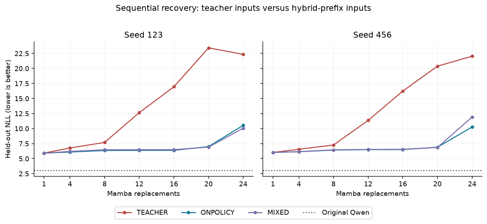

*Рисунок 1. Сохранённая NLL на отложенных данных EXP-072-v2 в зарегистрированных точках глубины замены, отдельно для каждого исходного сида. Линии соединяют зафиксированные оценки. Это зависимость от глубины, а не кривая обучения по времени.*

### 4.3 Переполнение нормы и неудача обучения — разные явления

В EXP-097 все четыре ветки NAIVE останавливаются при попытках шагов 4341, 3207, 5331 и 4752. Значения прямого прохода, функции потерь, элементов градиента, текущего состояния и вариантов обновления SAFE на том же состоянии остаются конечными, тогда как норма, вычисленная в FP32 через сумму квадратов, становится неконечной. Конечные значения log10 нормы находятся между 19.43 и 20.12. Сами варианты обновления NAIVE также зарегистрированы как конечные: непосредственная причина остановки — явная проверка нормы, а не обнаружение NaN в параметрах.

Все восемь веток SAFE завершают 8192 шага. Отдельные траектории SAFE расходятся с NAIVE ещё до события остановки; это не доказывает, что переключение уже остановленной траектории на SAFE восстановило бы её качество. EXP-097 проходит критерий численной диагностики, который уже критерия полезного восстановления модели.

### 4.4 Защищённое низкоранговое восстановление улучшает NLL, но оставляет плато

Заранее выбранная защищённая ветка ранга 32 в EXP-097 достигает NLL на отложенных данных 7.2668/7.3098 из начальных 12.9680/12.2770. Каждая траектория использует 8192 окна длиной 256: 2,097,152 дополнительных входных токена или 2,088,960 целевых предсказаний следующего токена. Этот подсчёт исключает обучение начального подготовленного состояния и отличается от бюджета всей серии, суммированного по веткам. NLL исходного Qwen на этом срезе равна 2.9803. В EXP-097 эффект защиты смешан с эффектом ранга при сравнении с вариантом ранга 8.

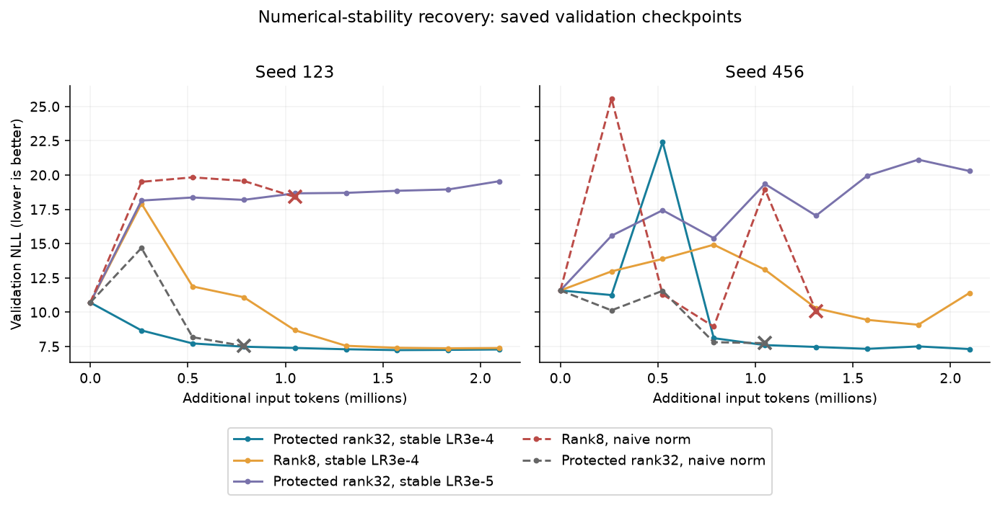

*Рисунок 2. Валидационная NLL EXP-097 в зависимости от дополнительных входных токенов, отдельно по сидам. Эти значения получены на другом срезе, чем тестовые начальные 12.97/12.28, приведённые в тексте. Неудачные траектории заканчиваются на последней сохранённой валидации; кресты обозначают эту точку, а не точный момент остановки. Отсутствующие конечные тестовые значения не подставляются. Стоимость подготовки не показана.*

EXP-098 отдельно проверяет защиту при ранге 32. Её преимущество на Wiki составляет 6.3155/0.0556 NLL; второй сид не достигает зарегистрированного порога улучшения 0.1. PG-19 благоприятствует защите на обоих сидах, но общий критерий по двум доменам не выполнен. EXP-099 не устанавливает пользу увеличения ранга защищённой поправки до 64. Позднее привязывание к учителю в EXP-101 приводит к компромиссу между доменами, а разблокировка динамики в EXP-103 не улучшает парный результат. В EXP-102 предпочтения по скорости обучения противоположны для Wiki и PG-19.

Короткое восстановление всего декодера и только Mamba в EXP-104/105 не проходит парные критерии. Более длинное восстановление всего декодера в EXP-106 завершает обе траектории по 32768 шагов, улучшая NLL на Wiki лишь на 0.0145/0.0650, а на PG-19 — на 0.0124/0.0874 относительно собственных начальных состояний. EXP-108–110 остаются частичными: сравнение в общей точке 24576 окон не устанавливает устойчивой пользы накопления батча или клиппинга по группам слоёв. Конечные критерии на 65536 окнах остаются непроверенными. Эти результаты ограничивают проверенные схемы, но не определяют причину плато и не доказывают архитектурный предел качества.

### 4.5 Предварительные контроли эффективности и локальные вмешательства

EXP-111 завершает 32768 обновлений на сид и достигает NLL 7.3451/7.3098 на новом заранее зафиксированном срезе Wiki и 9.9345/9.9786 на PG-19. На повторно используемом историческом наборе первые два последовательных измерения ниже 7.5 приходятся на шаги 5120/6144 и 6144/7168 для сидов 123 и 456. Это воспроизводит существенное начальное восстановление, но не достигает NLL 7.0 и не устраняет последующие колебания.

EXP-113 завершает обе траектории по 32768 обновлений с исходной случайной инициализацией Mamba, CE всего декодера и выбранной по валидации скоростью обучения 1e-4. На этом шаге NLL нового зафиксированного среза Wiki составляет 7.7062/9.0913, а PG-19 — 11.1829/11.7925 против 7.3451/7.3098 и 9.9345/9.9786 у EXP-111. Оба конечных состояния зарегистрированы как сохранённые, ожидающих загрузок нет. Случайное восстановление резко немонотонно: историческая NLL сида 123 меняется с 7.5855 на шаге 21504 до 17.0469, 18.6624 и 29.6866 на следующих трёх оценках, а затем возвращается к 7.5832 на шаге 26624. Ни один сид к зарегистрированному концу не подтверждает два последовательных исторических измерения ниже 7.5.

EXP-112 использует ту же начальную эффективную модель, что и EXP-111: сохранённые начальные оценки точно совпадают для обоих сидов. Выбранная по валидации скорость обучения равна 3e-4; запуск останавливается по зарегистрированному лимиту сессии с сохранёнными состояниями MAIN на шагах 12288/8642. В общей точке 8192 обновлений — 2.0972 млн входных токенов MAIN на сид — NLL нового среза Wiki равна 15.9941/13.5068 у EXP-112, 11.9960/30.6360 у EXP-113 и 7.5094/7.3806 у EXP-111. Короткие пилотные прогоны скорости обучения не гарантируют устойчивости оптимизатора на длинной траектории; частичное сравнение всего декодера не устанавливает его конечное достижимое качество.

EXP-111 использует 16.7772 млн обучающих входных токенов суммарно по обеим траекториям MAIN; EXP-113 — 18.3501 млн, включая все пилотные прогоны скорости обучения и оплаченный повтор выбранного пути. Зафиксированное время обучения составляет соответственно 5.503 и 7.130 часа, а суммарное время исполнения runner — 6.514 и 10.055 часа; EXP-113 охватывает две сессии. Кривые MAIN не включают пилотные токены и подготовку начального состояния. Число предъявлений токен-позиций на выбранном пути подготовки восстановлено в разделе 3.4; полные вычислительные затраты подготовки, проходы учителя и поиск остаются неучтёнными. Эти наблюдения поддерживают защищённую схему восстановления в измеренных бюджетах, но не изолированное превосходство инициализации, универсальный коэффициент ускорения или сравнение полного процесса при равных затратах. Ни один из EXP-111–113 не достигает исторической NLL 7.0 на наблюдаемом горизонте.

Диагностические откаты без обучения выявляют вредные изменения, зависящие от этапа. В EXP-113 для сида 456 на шаге 8192 возврат только слоя 8 к его собственному начальному поддереву параметров уменьшает NLL на диагностическом наборе из восьми окон с 30.3624 до 13.2122, тогда как откат соседнего слоя 9 увеличивает NLL на 1.2276. В EXP-111 откат слоя 26 на поздних проверках резко ухудшает оба сида, несмотря на большое несовпадение его вклада с исходным Qwen. Все зарегистрированные тождественные контроли отката имеют нулевую ошибку NLL. Эти выбранные вмешательства на валидации демонстрируют локальные эффекты в конкретной композиции; они не устанавливают универсальный проблемный слой, готовый способ лечения откатом или причину плато.

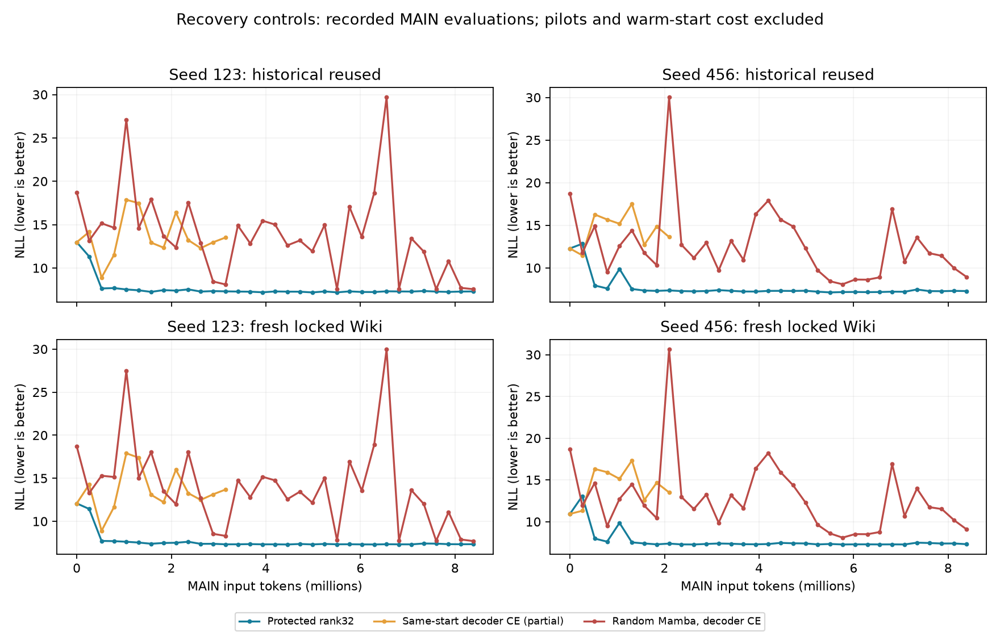

*Рисунок 3. Выбранные траектории MAIN для завершённых EXP-111 и EXP-113 и частичного EXP-112, с отдельным показом исторических и новых зафиксированных оценок Wiki. Сглаживание и подстановка отсутствующих конечных точек не применяются. Ось X исключает пилотные затраты и подготовку; схемы различаются обучаемым подпространством, инициализацией, скоростью обучения и разогревом. Линии соединяют наблюдения и не подразумевают промежуточных измерений. Изолированный вывод об инициализации или полной стоимости из них не следует.*

### 4.6 Один контроль масштаба не устраняет плато

В общей точке 4,096 обновлений EXP-129 защищённый контроль rank32 получает NLL A/B/C 7.2109/7.2627/6.9560, а нормализация перед гейтом — 7.2422/7.2875/6.9897. Таким образом, проверенная нормализация не улучшает качество, несмотря на большое уменьшение внутренних масштабов. На сохранённом диагностическом окне RMS выхода слоя 26 снижается примерно с 1.30e13 в контроле до 3.06e6 с нормализацией. Доля прибавлений MLP, округлившихся обратно к входящему остаточному сигналу, уменьшается с 99.994% до 97.286%, но остаётся высокой. Эта статистика поглощения измеряет численное сложение на данном окне, а не смысловую полезность MLP или доказанную причину NLL.

EXP-125–128 дают дополнительное наблюдение на 4,096 обновлениях. Относительное ограничение RMS выхода Mamba на уровне 0.5 вместе с потолком RMS остаточного потока 100 улучшает A/B/C с 7.2417/7.2876/6.9893 до 7.0102/6.9924/6.6983. Однако более поздняя точка на шаге 7,523 ухудшается до 7.8356/7.7882/7.5983. Потолок 10 и более агрессивные покомпонентные ограничения не дают устойчивой пользы. Масштаб влияет на качество, но его снижение и уменьшение числа поглощённых прибавлений недостаточны как критерии восстановления.

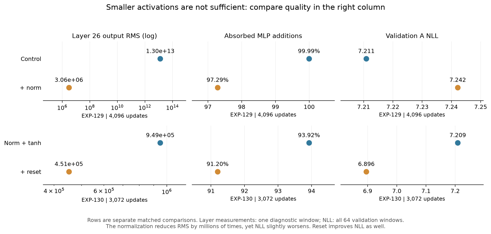

*Рисунок 4. Отдельные столбцы сравнивают RMS выхода слоя 26, долю поглощённых прибавлений MLP и NLL всего набора A. В каждой строке синий обозначает контроль, оранжевый — вмешательство. Диапазоны осей между строками независимы. Каждая точка использует профиль, прошедший проверку согласия диагностического и обычного вычисления с допуском 2%. Точки EXP-129 согласованы на 4,096 обновлениях; точки EXP-130 — отдельная согласованная пара на 3,072. Профили описывают одно диагностическое окно, тогда как NLL усреднена по набору A64. Две строки являются отдельными сравнениями и не образуют непрерывную последовательность вмешательств. Само по себе большое уменьшение масштаба не гарантирует улучшения NLL.*

### 4.7 Совместный сброс динамики и коэффициентов улучшает проверенное продолжение

В общей точке 3,072 обновлений ветка EXP-130 с совместным сбросом улучшает все три набора относительно одной нормализации с tanh:

| Продолжение, везде 3,072 обновления | Набор A64 | Набор B32 | Набор C64 |
|---|---:|---:|---:|
| EXP-130: нормализация + tanh, защищённый R32 | 7.2088 | 7.2819 | 6.9932 |
| EXP-131: нормализация + tanh, разблокированный R32 | 7.2237 | 7.2930 | 7.0121 |
| EXP-131: разблокированный R32 + MLP32 | 7.2103 | 7.2705 | 6.9806 |
| **EXP-130: нормализация + tanh + совместный сброс** | **6.8957** | **6.9440** | **6.6025** |

Разности NLL «сброс минус контроль» равны -0.3131/-0.3379/-0.3907. Более поздняя точка ветки со сбросом на шаге 3,434 достигает 6.7469/6.7733/6.4803; у контроля нет оценки на этом же шаге, поэтому это не согласованная оценка эффекта. К шагу 3,072 ветка со сбросом использует 786,432 дополнительные входные позиции без учёта значительной общей подготовки исходного состояния.

Одна разблокировка поправок динамики не воспроизводит эффект сброса; добавление MLP32 меняет число обучаемых координат с 7.18M до 14.52M без сопоставимого улучшения NLL на этом горизонте. Эти контроли указывают, что доступ к дополнительным координатам и замена существующих настроек — разные вмешательства. Они не устанавливают, что подготовка повредила модель, что rank32 сам по себе достаточен или что улучшение объясняется одним конкретным компонентом сброса. Сравнение чистого и подготовленного старта и отдельные абляции компонентов сброса пока отсутствуют.

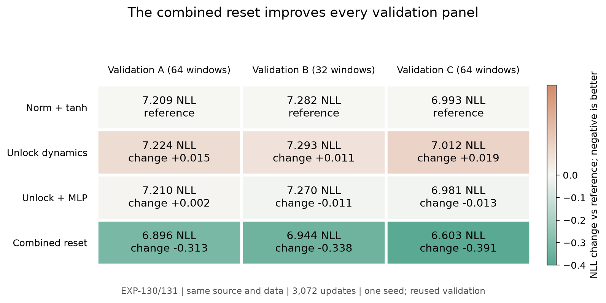

*Рисунок 5. Матрица сравнения с подписями: каждая ячейка показывает абсолютную NLL и разность с контролем «нормализация + tanh»; зелёный обозначает улучшение, коричневый — ухудшение. Четыре продолжения на одинаковом шаге 3,072, с одним исходным чекпоинтом и совпадающими хешами фактических обучающих и оценочных токенов. Все вмешательства полностью включены. Наборы показаны отдельно; используется только исходный сид 123. EXP-130 и EXP-131 — разные сессии с совпадающими условиями общих настроек, а не независимые повторения. Из трёх повторно используемых наборов доверительный интервал не выводится.*

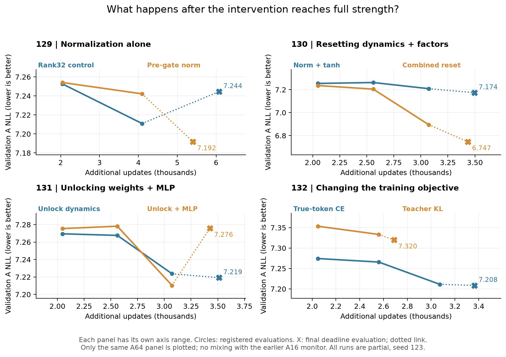

*Рисунок 6. Зарегистрированные оценки полного набора A64 после перехода длительностью 2,048 обновлений. Каждый подграфик имеет собственный диапазон осей, чтобы показать траекторию внутри эксперимента; визуальные величины наклонов между подграфиками несопоставимы. Ранний монитор A16 исключён, а не присоединён к A64. Кружки — зарегистрированные оценки; маркеры X и пунктирные соединения обозначают отдельно оценённые произвольные последние шаги, а не выбранные задним числом лучшие чекпоинты. Линии соединяют измерения без сглаживания или вывода промежуточных значений. Оси X показывают дополнительные обновления в тысячах — 256 входных позиций на обновление — без подготовки и обучения EXP-111. Все восемь процессов остановились по времени до достижения запланированного горизонта.*

Последняя проверка контекста ветки со сбросом на одинаковых конечных целевых токенах даёт NLL 6.5371 при контексте 128 и 6.5278 при контексте 1024. Небольшая разница не демонстрирует восстановления полезности длинного контекста. Низкая NLL на коротких окнах недостаточна как свидетельство качества рекуррентной памяти.

### 4.8 Короткая чистая дистилляция не улучшает это подготовленное состояние

EXP-132 использует состояние с разблокированными поправками и MLP, без сброса EXP-130. На общей точке 2,560 обновлений CE получает NLL A/B/C 7.2657/7.2611/7.0322 против 7.3333/7.3543/7.0857 у чистой forward KL. Зафиксированное время обучения на принятое обновление составляет 5.39 против 6.88 секунды на отдельных процессах T4 — примерно на 28% больше для KL. Для процесса KL учтены 688,384 входные позиции учителя, включая одну попытку обновления сверх принятого шага; принятых позиций студента — 688,128. Это измеренное сравнение времени данной реализации, а не независимое от оборудования отношение FLOPs.

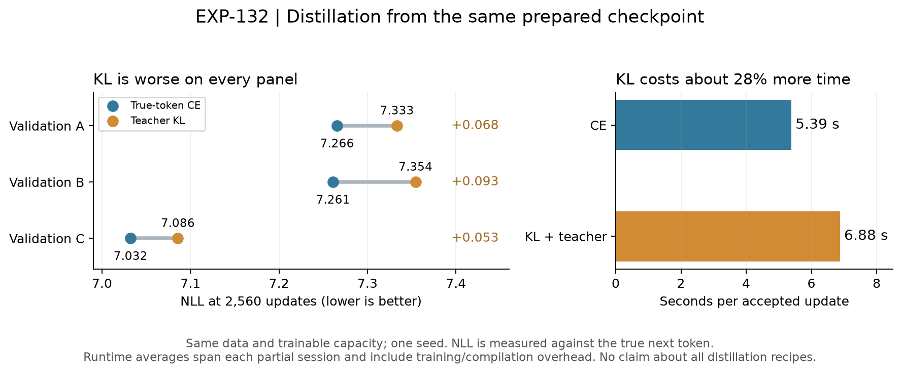

*Рисунок 7. Слева: парные точки CE/KL для каждого проверочного набора на одинаковом шаге 2,560, с подписями разности «KL минус CE». Измеряется NLL настоящего следующего токена на отложенных данных, а не обучающая KL; наборы — отдельные категории, не соединённые в кривую. Справа: зафиксированные секунды обучения, делённые на принятые обновления за полученную сессию каждого процесса, включая накладные расходы обучения и компиляции. Качество согласовано по обновлениям; время усреднено на разных достигнутых горизонтах. Источник, данные и обучаемая ёмкость совпадают; один сид, частичные горизонты. Результат не отвергает более длинную дистилляцию, обучение всех параметров Mamba или дистилляцию после совместного сброса.*

Для всех восьми процессов EXP-129–132 финализация завершена, а сохранённые шаги совпадают с принятыми. Проверки воспроизведения исходного состояния и вычисления с нулевой силой вмешательства пройдены. Качество измеряется обычным вычислением конечной NLL. Некоторые диагностические профили EXP-131 превышают порог согласия 2%, максимум — 4.88%; эти профили исключены из рисунка 4 и не используются как проверенное объяснение механизма. Этот анализ выполнен по сохранённым данным и не означает проведения новых облачных вычислений.

### 4.9 Длинные продолжения опускаются ниже прежнего плато

Ветка совместного сброса продолжает улучшаться за пределами короткого EXP-130. EXP-136 FULL достигает NLL A/B/C 6.000789/6.004432/5.617432 за 12,586 обновлений (3.2220 млн входных позиций) из подготовленного состояния EXP-111. EXP-145 сворачивает обученную поправку в замороженную базу и добавляет новую поправку ранга 32 с нулевым начальным выходом и свежим Adam; проверка воспроизведения исходной NLL проходит. После ещё 12,379 обновлений его последний checkpoint достигает 5.782680/5.804467/5.364202. EXP-147 сохраняет эти факторы и моменты Adam и за следующие 6,161 обновление достигает 5.692111/5.718191/5.292497. Это этапы одной выбранной линии, а не независимые успехи и не одна неизменная траектория оптимизатора.

Обычное продолжение ранга 32 в EXP-154 сохраняет модель EXP-147 и Adam. Оно принимает ещё 4,994 обновления (1,278,464 входных токена) и достигает 5.616958/5.675724/5.247005. Общий статус кампании — failed из-за отдельного worker со сворачиванием, который не дошёл до обучения; обычный worker нормально остановился по лимиту времени. Наблюдения поэтому не подтверждают жёсткий предел на 7, 6 или 5.69. Прогресс немонотонный и не гарантирует последующего достижения качества учителя.

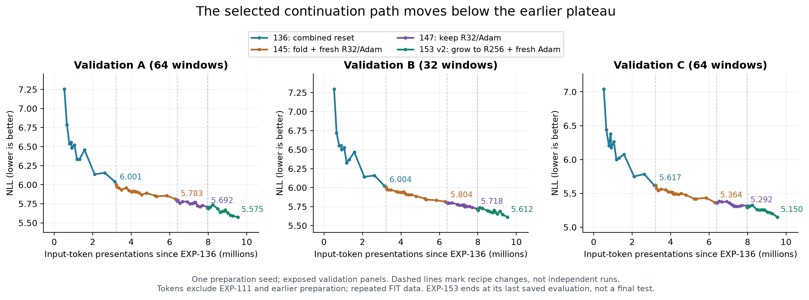

*Рисунок 8. Отдельные кривые A/B/C вдоль выбранного пути EXP-136 → 145 → 147 → 153-v2-R256. Пунктирные границы отмечают изменения схемы обучения. Показаны исходные измерения без сглаживания. EXP-136 начинается с первой оценки полных панелей на 2,048 обновлениях; более ранние измерения A16 исключены. Ось X считает предъявления входных позиций с начала EXP-136 и исключает обучение EXP-111 и более раннюю подготовку; конечный набор FIT используется повторно. EXP-153 v2 заканчивается последней сохранённой оценкой, а не более поздним шагом сохранённых обученных весов. Старые измерения 12 → 7 на других срезах к этой кривой не пришиваются.*

На глобальном шаге 37,270 путь R256 обработал 9,541,120 входных позиций с начала EXP-136: 12,586 + 12,379 + 6,161 + 6,144 обновления длиной 256. Это дополнительные затраты выбранного пути после уже обученного источника EXP-111, а не полная стоимость метода, число уникальных токенов или все расходы на поиск гипотез. Значения 5.150 на C и 5.575 на A относятся к разным текстовым срезам и не являются последовательными достижениями на одной шкале.

### 4.10 Контроли показывают небольшой выигрыш сворачивания и продолжающееся обучение на исходном LR

Недостающий контроль EXP-145 исправлен в EXP-148: из того же источника EXP-136 он сохраняет факторы и сбрасывает Adam при одинаковых данных и скоростях обучения. На 6,144 новых обновлениях сворачивание с новой R32 лучше контроля на 0.026468/0.023714/0.043254 NLL по A/B/C. Это поддерживает небольшой выигрыш данной перепараметризации сверх одного сброса Adam. Чистый эффект ёмкости не выделен: сворачивание также округляет замороженные веса в BF16 и меняет координаты оптимизации. Контроль пока не достиг более длинного бюджета EXP-145.

Два продолжения не поддерживают преждевременное уменьшение LR. Из общего источника EXP-138 CE исходный LR в EXP-144 лучше LR/3 на 10,240 одинаковых новых обновлениях на 0.050579/0.037947/0.030296 NLL по A/B/C. Из более позднего источника EXP-145 эксперименты EXP-147/148 сравнивают исходный LR, LR/3 и LR/10. На 4,096 новых обновлениях исходный LR выигрывает все панели; на 5,120 почти равен LR/3 по A, но лучше по B/C. Меньшие скорости могут помогать в начале, поэтому результат зависит от горизонта. Универсально оптимальный LR не установлен.

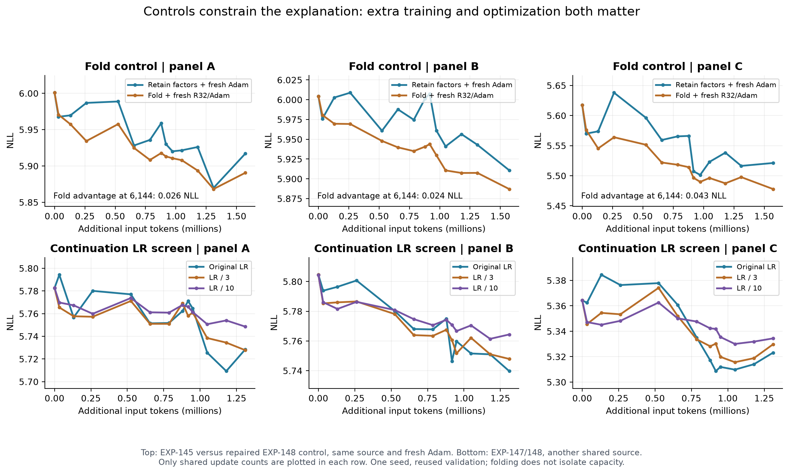

*Рисунок 9. Сверху: сворачивание с новой поправкой в EXP-145 против сохранения факторов в EXP-148, в обоих случаях со свежим Adam. Снизу: исходный и уменьшенные LR из другого общего источника в EXP-147/148. Каждая строка использует свой источник и только общие точки числа обновлений; строки не образуют причинного сравнения между собой. Отдельные оси сохраняют различие A/B/C и показывают колебания. Это поисковые сравнения на повторно используемой валидации.*

EXP-146 проверяет второй сид подготовки: FULL заканчивается на 5.976876/6.002024/5.614221 после 13,089 обновлений, сброс только проекций — на 6.118156/6.122296/5.740983 после 13,171. На одинаковых 10,240 обновлениях FULL также лучше по всем трём панелям. Это переносит качественный результат восстановления на сид подготовки 456, но данные, RNG сброса и валидационные панели общие; независимого подтверждения на другом корпусе нет. Малые контекстные проверки поздних продолжений не устанавливают полезного выигрыша от увеличения контекста 256 → 1024.

### 4.11 Рост ранга с сохранением исходной функции даёт перспективный поздний результат

EXP-153 v1 пытается дополнительно свернуть поправку EXP-147 перед добавлением свежих факторов ранга 64/256. Обе ветки не проходят проверку исходной NLL до начала обучения; ветка со сворачиванием и рангом 32 в EXP-154 не проходит ту же проверку. Это неудачи инициализации, а не свидетельство плохого обучения этих рангов. Точная численная причина пока не установлена.

Переписанный **EXP-153 v2** не делает этого дополнительного сворачивания. Он сохраняет обученные факторы ранга 32 и нормализацию перед гейтом, добавляет компоненты с нулевым выходом до общего ранга поправки 64 или 256 и обучает старые и новые факторы вместе. Обе ветки используют свежий Adam, одинаковые LR, исходный курсор данных и обучающие окна. Проверка исходной функции проходит на всех 160 валидационных окнах: максимальное расхождение NLL меньше 0.00128 при допуске 0.03. Срез закреплён на HF revision `db3ae61fc99cb3baa10d6f7236f9895654527dc2`.

| Одинаковая зарегистрированная точка: 6,144 новых обновления / 1,572,864 входных токена | NLL A64 | NLL B32 | NLL C64 |
|---|---:|---:|---:|
| EXP-153 v2, общий ранг поправки 64 | 5.604823 | 5.636056 | 5.194702 |
| EXP-153 v2, общий ранг поправки 256 | **5.575060** | **5.611766** | **5.149767** |
| R64 минус R256 | 0.029763 | 0.024290 | 0.044935 |

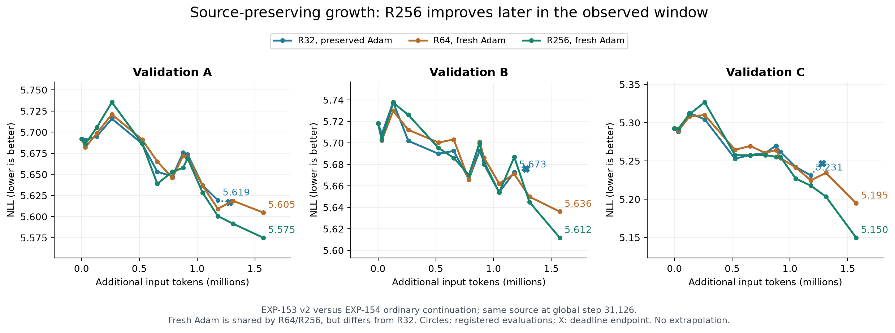

*Рисунок 10. EXP-153 v2 и успешный обычный worker EXP-154 начинают с одного глобального шага 31,126. Кружки — зарегистрированные оценки; крест — отдельно оценённый конечный шаг EXP-154. R64/R256 сбрасывают Adam, R32 сохраняет его. Горизонт R32 короче: его кривая не экстраполируется, а конечные точки роста на 6,144 обновлениях не объявляются равными ему по затратам. Диапазоны осей различаются между панелями. Доверительные интервалы и сглаживание не добавлены.*

На общих 4,608 обновлениях A для R32/R64/R256 равна 5.619403/5.609289/5.600626, B — 5.672699/5.671008/5.686834, C — 5.231323/5.224713/5.217819. Таким образом, R256 не превосходит обычное продолжение повсюду: по B он хуже в этой общей точке. Преимущество R256 над R64 по всем панелям появляется позднее в сохранённом окне. Это кандидат для продолжения, а не воспроизведённый закон ёмкости и не доказательство устранения ограничения одним рангом. Контроля R32 со свежим Adam из того же источника пока нет.

Отчёты содержат 7,168/6,784 принятых обновления и сохранённые шаги 38,294/37,910 для R64/R256, но последняя зарегистрированная оценка обеих веток относится к 6,144 новым обновлениям. Таблица описывает оценённую точку, а не более поздние веса без оценки. Оба отчёта ещё имеют статус `running`; завершение и финальная оценка не подтверждены. Части checkpoint с текущими весами, Adam и выбранными лучшими состояниями скачаны локально и проверены по SHA: это проверка целостности байтов, а не новая оценка качества всей модели.

### 4.12 Обзор истории восстановления и учёт токенов выбранной цепочки

EXP-155 продолжает ветку ранга 256 с сохранённого глобального шага 37,910, сохраняя обученные факторы и состояние Adam. За 42,350 дополнительных принятых обновлений — 10,841,600 входных токен-позиций — запуск достигает штатного лимита времени работы. На глобальном шаге 80,260 NLL последнего чекпоинта на A/B/C равна **5.109496/5.150924/4.665559**. Чекпоинт на шаге 78,870, выбранный по A, имеет другие значения: 5.122928/5.152130/4.645769; эти конечные точки не взаимозаменяемы. Поздние зарегистрированные измерения продолжают улучшаться на всех трёх наборах. Это не гарантирует дальнейшего прогресса и не выделяет ранг как единственную причину улучшения.

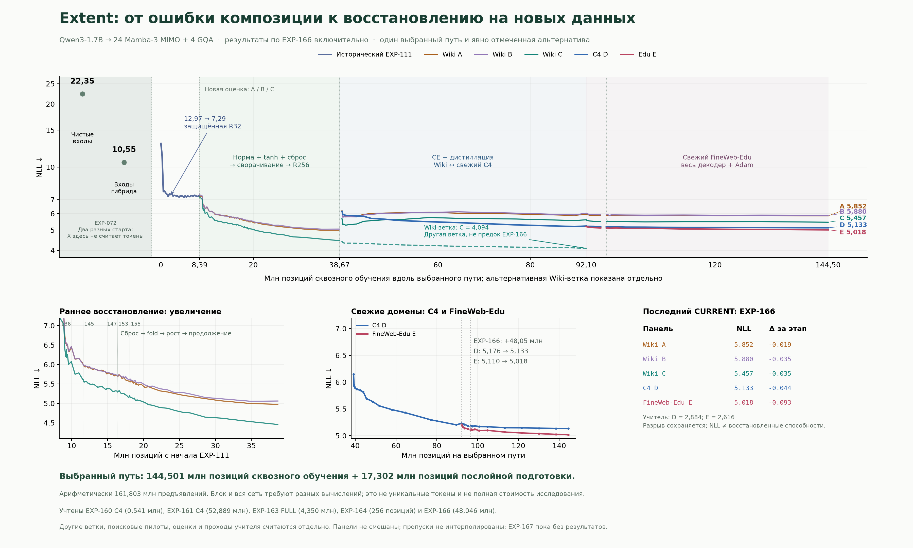

*Рисунок11. Обзор до EXP-166 включительно. Две точки EXP-072 относятся к разным подготовленным моделям и не имеют токеновой координаты. Историческая оценка EXP-111 отделена от A/B/C. Выбранный путь после EXP-155 переходит к свежему C4, затем FineWeb-Edu и полному декодеру; пунктирная Wiki-C — отдельная альтернатива, а не предок EXP-166. Линии не соединяют разные оценочные панели и не заполняют неизмеренные промежутки этапов. Вставки показывают раннее восстановление, свежие домены и точные конечные изменения. Ось токенов считает предъявления входных позиций всей модели на выбранном пути, без суммирования альтернативных веток и проходов учителя.*

Обзор теперь учитывает путь до EXP-166, а не только до первой сессии EXP-155. Выбранная цепочка содержит **144,501,248 входных позиций сквозного обучения**: 8,388,608 в EXP-111; 3,222,016 в EXP-136; 3,169,024 в EXP-145; 1,577,216 в EXP-147; 1,736,704 в EXP-153 v2 до выбранного источника EXP-155; 20,580,864 за обе сессии EXP-155; 541,440 в выбранном C4-префиксе EXP-160; 52,889,088 в EXP-161 C4; 4,349,952 в EXP-163 FULL; 256 в EXP-164; ноль принятых обучающих позиций в EXP-165; 48,046,080 в EXP-166. Короткий префикс EXP-160 также включён: без него стоимость была бы занижена. Отклонённые предложения обновлений и инженерные пробы считаются отдельно от принятого обучения.

Отдельно восстановленная послойная подготовка добавляет **17,301,504 позиции обучения блоков**, что арифметически даёт **161,802,752 предъявления позиций**. Здесь смешана работа блока и всей сети: это не уникальные токены и не эквивалент бюджета обучения всей модели по FLOPs. Прямые проходы учителя для CE/KL добавляют вычисления, но не удваивают число входных позиций студента. Другие исследовательские ветки, построение кэшей, оценки и отдельные12,288 позиций ridge-калибровки не включены. EXP-097 — отдельная диагностика, а не дополнительный предок; EXP-130 выявляет рецепт сброса, но EXP-136 повторяет его из EXP-111.

Точки рисунка, хеши источников и счётчики этапов сохранены в [progress_overview_points.csv](figures/progress_overview_points.csv) и [progress_overview_provenance.json](figures/progress_overview_provenance.json); [make_progress_overview.py](make_progress_overview.py) пересобирает обзор без запуска моделей. Этот учёт описывает одну выбранную цепочку модели, а не полную стоимость исследования или доказанное превосходство при равных затратах.

### 4.13 Разнообразие данных меняет траекторию восстановления

Вторая полученная сессия EXP-155 продолжает ту же линию rank256 до CURRENT118304: NLL A/B/C достигает **4.975879/5.061456/4.457787**. Именно это состояние используется в последующих сравнениях данных и дистилляции; оно позже показанного прежде конечного шага80260.

EXP-160 вводит смесь 0.5 CE по настоящему следующему токену и0.5 forward KL от замороженного исходного Qwen при температуре1. EXP-161 продолжает каждую ветку с её Adam, batch6 и длиной256. Одна ветка циклически использует прежний обучающий пул Wiki; другая читает последовательные свежие окна C4 без неявных повторных эпох. Одновременно меняются домен и разнообразие текста: это не изолированная проверка разнообразия или универсального превосходства корпуса.

| Последний CURRENT EXP-161 | Новые токены EXP-161 | Wiki A | Wiki B | Wiki C | C4 D | Английские рассказы128 | Русская Wiki128 |
|---|---:|---:|---:|---:|---:|---:|---:|
| Циклическая Wiki | 53.096 млн | 4.6476 | 4.7463 | 4.0945 | 7.0781 | 6.1032 | 11.2334 |
| Свежий C4 | 52.889 млн | 5.9589 | 6.0233 | 5.6023 | 5.2313 | 4.6167 | 7.7625 |

Конечные бюджеты немного различаются: это описание последних состояний, а не точный эффект при равном числе токенов. Ветка C4 улучшает более широкие текстовые проверки ценой ухудшения многократно использованных панелей Wiki. Выбор только по минимальному историческому Wiki NLL скрыл бы этот обмен качеством. Источником следующих экспериментов полного декодера становится C4 CURRENT154852; исторический BEST, выбранный по A, вместо него не подставляется.

Для свежих корпусов зафиксированы ревизии данных и токенизатора, объединение документов через EOS, нормализованная дедупликация точных документов и отдельно зарезервированная валидация. C4 — английская часть `allenai/c4`; следующий этап использует `HuggingFaceFW/fineweb-edu`, `sample-10BT`. Каждый подготовленный обучающий поток содержит100 млн позиций при длине256 и читается последовательно. Проверки точных документов не доказывают семантическую дедупликацию, очистку от бенчмарков или отсутствие текста в исходном претрейне Qwen.

### 4.14 Полный декодер даёт небольшой выигрыш, но не устраняет плато

Поздний результат полного декодера отличается от более раннего вмешательства с чистой CE в EXP-157. При общих8,192 обновлениях из CURRENT118304 rank256 имеет NLL A4.9509, полный декодер с CE —10.0811. Этот неудачный рецепт не означает невозможность полной адаптации; в EXP-163 меняются подготовленный источник, данные и целевая функция, поэтому поздний выигрыш не является изолированным эффектом добавления дистилляции.

EXP-163 запускает три рецепта из одного C4 CURRENT154852, на одинаковом свежем префиксе FineWeb-Edu и со свежим Adam. Обучаются поправки rank256, те же поправки вместе с восемью верхними MLP либо все28 блоков декодера. В последнем случае обучаются1,364,173,952 координаты; эмбеддинги и конечная нормализация/выходная голова заморожены. LR между рецептами различается, поэтому это сравнение практических схем адаптации, а не только числа параметров.

При ровно2,048 обновлениях /3,145,728 входных позициях на вариант:

| Рецепт EXP-163 | Обучаемые координаты | Wiki A | C4 D | Edu E | Английские рассказы16 |
|---|---:|---:|---:|---:|---:|
| Rank256 | 57.2 млн | 5.8980 | 5.2474 | 5.1130 | 4.6625 |
| Rank256 + восемь верхних MLP | 359.2 млн | 5.9081 | 5.2474 | 5.1134 | 4.6655 |
| Весь декодер | 1,364.2 млн | 5.8676 | 5.1843 | 5.1263 | 4.5555 |

Полный декодер здесь лучше ограниченной адаптации на D и английских рассказах, но Edu E немного лучше у ограниченных рецептов. Полная финальная диагностика EXP-163 не завершена; последующие оценки восстановленного источника нельзя выдавать за общие конечные результаты всех вариантов при равной работе. Полная ветка успевает2,832 обновления /4,349,952 входных токена. EXP-164 принимает ещё одно обновление на256 позициях; EXP-165 не принимает ни одного. Их отказы выделения памяти — инженерные неудачи, а не результат проверки качества.

EXP-166 продолжает полученный CURRENT157685 с Adam2833 и курсором Edu16993. Сохраняется смесь CE/KL; используется физический batch8 с одним обновлением оптимизатора на батч. Градиенты проходят через весь декодер; промежуточное хранение активаций не превращает обучение в независимую подгонку слоёв. За23,460 принятых обновлений /48,046,080 дополнительных входных позиций:

| Фиксированная панель | Источник | Последний CURRENT181145 | Изменение |
|---|---:|---:|---:|
| Wiki A64 | 5.8702 | 5.8516 | −0.0187 |
| Wiki B32 | 5.9148 | 5.8803 | −0.0345 |
| Wiki C64 | 5.4912 | 5.4567 | −0.0345 |
| C4 D128 | 5.1764 | 5.1328 | −0.0436 |
| FineWeb-Edu E128 | 5.1104 | **5.0175** | **−0.0929** |

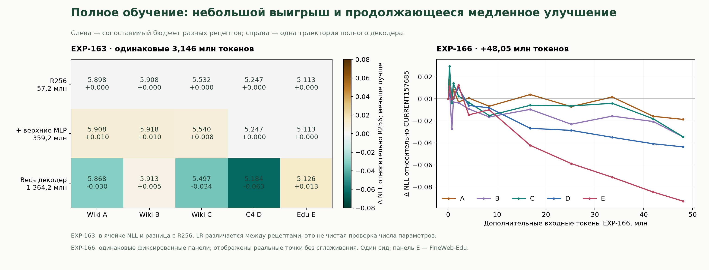

*Рисунок12. Слева: абсолютный NLL и отличие от rank256 при ровно3.146 млн новых входных позиций в EXP-163. Цвет кодирует разницу, а не абсолютный NLL. Справа: изменение относительно одного источника на каждой фиксированной панели A-E в EXP-166, включая отдельно оценённый последний CURRENT. Соединены реальные измерения без сглаживания. Один исходный сид, повторно использованные диагностические панели; различия LR не позволяют приписать левое сравнение только числу параметров.*

Edu E продолжает снижаться5.0516 →5.0392 →5.0258 →5.0175 при25.17/33.55/41.94/48.05 млн новых токенов. Полной остановки нет, но дополнительный выигрыш невелик относительно бюджета. Итоговый NLL на128 окнах английского/русского текста равен4.5077/7.5426; исходные мониторы на16 окнах не являются прямой базой для этих значений. Исходный Qwen существенно лучше на тех же D/E:2.8844/2.6159. Текущий LR смесителей и MLP —1e-5, нормализаций/pregate —1e-6. **Эти кривые не доказывают, что ограничение вызвано LR.** Подготовлен EXP-167: сравнение1×/3×/10× от того же CURRENT с сохранённым Adam и равными бюджетами свежих токенов; результатов качества EXP-167 ещё нет.

### 4.15 Предсказание текста и прикладные способности остаются разными результатами

В EXP-156 более ранний зафиксированный EXP-155 CURRENT80260 сравнивается с исходным учителем на одинаковых zero-shot запросах и общих примерах. Частичный запуск содержит808 общих примеров ARC-Easy и по807 в остальных задачах. Основная точность гибрида/учителя:28.47%/66.71% на ARC-Easy,23.54%/45.72% на ARC-Challenge,52.04%/77.20% на PIQA,48.95%/62.95% на WinoGrande,27.01%/67.66% на HellaSwag и22.06%/62.58% на zero-shot MMLU. Для ARC/PIQA/HellaSwag используется нормализованное правдоподобие ответа, для WinoGrande/MMLU — accuracy. Ограниченные выборки не являются официальными полными оценками или five-shot MMLU. Они показывают большой разрыв способностей на том чекпоинте, несмотря на улучшенный NLL своего домена; способности более позднего EXP-166 этим запуском не измерены.

EXP-159 отдельно сравнивает смесь CE/KL с добавлением согласования скрытых состояний из того же подготовленного источника. При6,144 обновлениях /1.573 млн новых токенов A/B/C для обучения только по выходам равен4.903925/5.017014/4.423783, с дополнительной внутренней потерей —4.903264/5.012825/4.415786. Различия малы и получены на одном сиде: проверка не устанавливает существенного преимущества внутренней дистилляции и не отвергает другие веса потерь, горизонты или представления.

## 5. Обсуждение и оставшееся сравнение эффективности

Данные разделяют четыре вопроса: точность локального отображения параметров, совместимость при композиции, корректность численных операций обучения и стоимость достижения полезного качества. Решение одного вопроса не устанавливает решение остальных. Защищённое низкоранговое восстановление остаётся рабочим кандидатом; последовательное восстановление с учётом входов и диагностика переполнения нормы имеют согласованные исторические контроли. Недавний совместный сброс даёт более сильный поисковый результат продолжения, чем один контроль масштаба. Компонент, отвечающий за эффект, и зависимость от подготовки пока не установлены. Поздние продолжения расширяют горизонт и включают второй сид подготовки, но не устанавливают широкую устойчивость по сидам.

EXP-111 проверяет защищённое восстановление rank32 из исходного подготовленного ONPOLICY-состояния; EXP-112 использует обычную CE всего декодера из той же эффективной модели; EXP-113 — обычную CE со случайными поддеревьями Mamba и остальными весами исходного Qwen. Контроли всего декодера получают заранее определённые пилотные прогоны скорости обучения с выбором по валидации. Все затраты поиска и повторных проходов должны учитываться. Дополнительная стоимость восстановления будет отделяться от полной стоимости подготовки и восстановления; учитываются и попытки, не достигшие порога качества; экстраполяция за измеренные конечные точки не проводится. **Полное трёхстороннее сравнение и сравнение стоимости всего процесса пока недоступны.**

Более длинные траектории сброса и продолжения уже опускаются ниже прежнего плато. Последнее сравнение роста ранга с сохранением исходной функции поддерживает R256 против R64 на общем позднем измерении; обычное продолжение R32 также улучшается. Для исторического вывода о росте ранга по-прежнему нужны контроль R32 со свежим Adam и независимые сиды. Для текущей линии полного декодера ближайшая подготовленная проверка — сравнение LR при равных токенах EXP-167; результатов пока нет. Для выводов об инициализации и полной эффективности по-прежнему нужны чистый и подготовленный старты с ограниченной и полной адаптацией Mamba. До отнесения эффекта EXP-130 к конкретному механизму нужны раздельные сбросы компонентов. Результаты качества EXP-133/134 здесь не используются; отказы начальных численных проверок не считаются результатами обучения.

Для более сильной статьи о методе нужны воспроизведённые выигрыши эффективности, новая отложенная оценка, сравнение с релевантными схемами переноса и дальнейшая проверка масштаба и контекста. Выигрыш инференса требует оптимизированных реализаций и прямых аппаратных измерений; текущий эталонный последовательный scan не обосновывает утверждения об ускорении.

## 6. Ограничения

Основные результаты полной глубины относятся к одному семейству исходных моделей и двум повторяющимся сидам. Оценки охватывают разные срезы и численные реализации. Частичные модели, полные модели и поздние этапы восстановления различаются процедурой обучения и не могут быть объединены в одну кривую. Повторно используемые контроли дают зависимые наблюдения. Некоторые серии выполнены частично или потеряли конечные состояния модели, несмотря на сохранённые метрики. Все подтверждённые выводы о качестве ограничены зарегистрированными данными и горизонтами. EXP-125–132 — поисковые продолжения с одним сидом на многократно использованных наборах, а не независимое подтверждение. Совместный сброс нескольких компонентов не позволяет отнести эффект к единственному механизму; ни один эксперимент пока не выделяет, была ли историческая подготовка полезной или вредной при равной полной стоимости. Восстановление длинного контекста, качество 14B, совместная конверсия MLA, прикладные способности, полная стоимость процесса и эффективность оптимизированного инференса остаются неустановленными.

Последние данные роста ранга — зафиксированный частичный отчёт, а не завершённый эксперимент. Рост поправки и предыдущее сворачивание необходимо различать; сравнение с обычным продолжением также различается сбросом оптимизатора. Новые контроли сужают гипотезы, но не доказывают, что именно большие активации или малый ранг единолично вызывали плато. Отсутствующие результаты EXP-149–152 не считаются ни успешными, ни неудачными запусками. Все три поздние панели A/B/C многократно использовались; новая независимая оценка остаётся необходимой.

## Связанные работы для включения

- [Mamba-3: Improved Sequence Modeling using State Space Principles](https://proceedings.iclr.cc/paper_files/paper/2026/hash/8abd2043b71a074278d5f687947bff9c-Abstract-Conference.html).
- [The Mamba in the Llama: Distilling and Accelerating Hybrid Models](https://proceedings.neurips.cc/paper_files/paper/2024/hash/723933067ad315269b620bc0d2c05cba-Abstract-Conference.html).
- [Transformers to SSMs: Distilling Quadratic Knowledge to Subquadratic Models (MOHAWK)](https://proceedings.neurips.cc/paper_files/paper/2024/hash/3848fef259495bfd04d60cdc5c1b4db7-Abstract-Conference.html).
- [Attention to Mamba: A Recipe for Cross-Architecture Distillation](https://arxiv.org/abs/2604.14191).

Публичные [артефакты гибрида Qwen3-4B/Mamba-3 от arianraje](https://huggingface.co/arianraje/qwen3-4b-mamba3-hybrid-stage2b-kd-bias1), изученные в ревизии `b946069890837bbe9b5dd75e2d118a7e98d2d193`, использованы при проектировании контролей нормализации и сброса. Описанная в них схема имеет другую геометрию, долю сохранённого внимания, этапы примерно на 100M токенов согласования + 600M + 294M токенов дистилляции и более длинные контексты. Этот черновик не воспроизводит ту схему и не сравнивает с ней эффективность по токенам. Приведённые в артефактах значения перплексии не являются значениями NLL.

Перед подачей необходимо добавить проверенные библиографические сведения, подробное сравнение методов, вывод точного отображения, полные таблицы данных и оптимизаторов и приложение о происхождении результатов. Утверждение о первенстве в этом черновике не делается.
