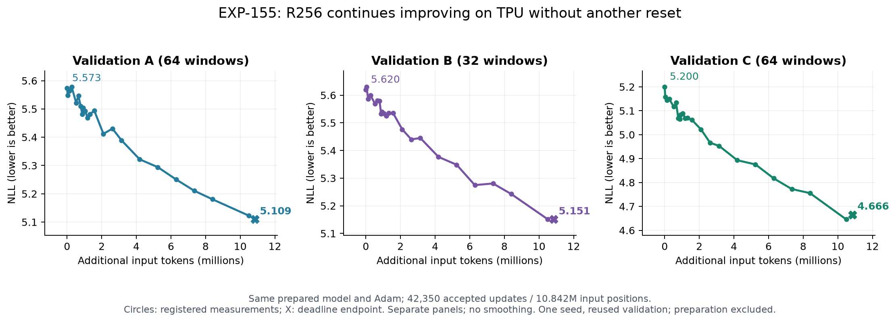

# EXP-155: valid TPU continuation reaches A5.109/B5.151/C4.666

Received23 October2026. Raw report archived byte-for-byte as EXP-155-session-1.json.
Offline rebuild/audit: `python scripts/analyze_exp155.py`; no training launched.

## Outcome and costs

Normal registered work deadline, not an exception. Campaign status
`deadline_partial` because the262144 NEW-update ceiling was not reached;
endpoint finalization completed.42,350 attempted and accepted updates,
10,841,600 input-token presentations and10,799,250 CE targets. The extra
unaccepted gradient-audit pass adds256 input positions separately.
Wall8.0262h, recorded training4.5446h. Remaining wall includes all nontraining
work; source loading/JIT/evaluation/saving are not individually timed here.
Frozen FIT repeats; these are not unique tokens, whole-project or prep costs.

| Panel | CURRENT37910 measured on TPU before training | Registered A-best78870 | Last80260 |
|---|---:|---:|---:|
|A64|5.573295|5.122928|5.109496|
|B32|5.619817|5.152130|5.150924|
|C64|5.200393|4.645769|4.665559|

Source-minus-last gains0.463799/0.468892/0.534834. Do not call last the registered
best: last improves A/B slightly but worsens C. Inherited153 selectedbest37270
had different weights from CURRENT37910 and is not the source-table row.

Late A at NEW20480/24576/28672/32768/40960:
5.293977/5.250849/5.210879/5.180658/5.122928.
At32768->40960 (2,097,152 additional input positions), A/B/C improve
0.057730/0.090708/0.109796. Progress remains nonmonotonic across all recorded
points; this window does not demonstrate a hard plateau. Continuation is
supported; extrapolation to eventual teacher quality is not.

69 full-panel measurements, no A16 splice, smoothing, or inferred intermediate
points. Circles registered; X separate arbitrary deadline endpoint.

## Actual TPU numerical checks

Eight TPUv5lite devices, single process. Inherited SELECTEDBEST37270 replay
passes all160 windows; max per-window error A.007880/B.010774/C.007079 <.03.
Source data and entire execution contract match the prepared plan.
Adam/schedule counts at restore all6784, not reset. CURRENT37910->80260.
First actual gradient parity passes relativeL2.029159/.15,
cosine.999575/.98,CEerror.000158/.03; compiled path selected, no fallback.
No numerical rejection/failed proposal. Source, last and best inspection
profiles pass consistency checks. Profiles do not uniquely explain recovery.

Tiny8window tail-context audit last256:4.944845 versus1024:4.958112;
selectedbest256:4.926964 versus1024:4.937913. No useful longer-context gain.

## Durability and recommendation

Report pending_slots=[], no storage/report-sync error, durable80260.
Read-only pinned HF revision74cd4878817a330e1ae8399acbafe5e76b40a4c5:
latest report agrees; checkpoint80260 with exact contract+arm confirmed,
871chunks/915,321,756bytes. Seven scalar chunks downloaded/SHAchecked:
six actual Adam/schedule counts49134 (=6784+42350), best_step78870.
See EXP-155-remote-audit.json. Full915MB payload not restored in this review.
Three Telegram messages: started, progress, finished. Upload3.696GB <8GB cap.

Prefer continuing CURRENT80260/Adam49134 on the same TPU runner/contract;
keep inherited registeredbest78870. Repeating original155 cell resumes OWN155,
not the older153 source. Do not reset/fold/increase rank just because a session
ended. No further run launched here. One preparation seed, reused validation,
no fresh independent test. This demonstrates effective continued training of
the existing R256 candidate, not an isolated benefit of rank256 or a complete
end-to-end efficiency comparison.
